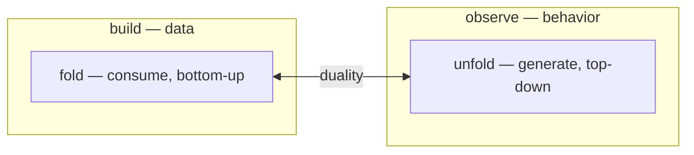

# Lapis — The Language, In One Document

> **Status:** Draft v0.1. This is the consolidated overview of Lapis's surface design: one document,
> sanity-checking the language end to end, and the seed for the marketing site. It is written
> example-first — every claim ends in a runnable block.
>
> This document is the **10,000ft view** — a gut-check on the syntax. The **normative production
> set** is the header of [`src/surface/grammar.ts`](../src/surface/grammar.ts): the executable
> grammar, whose `@rule` methods _are_ the productions. The authoritative specifications remain
> [`theory/surface-syntax.md`](./theory/surface-syntax.md) (syntax) and
> [`theory/semantics.md`](./theory/semantics.md) (meaning); each section links to its backing spec
> rather than duplicating it. Formal vocabulary (initial algebra, coalgebra, and friends) lives in
> those specs; this page keeps to plain language. Where this document and the code disagree on the
> _shape_ of the syntax, the code wins — and the findings in §12 record which questions the grammar
> still leaves open.
>
> Sources consolidated here: `surface-syntax.md`, `surface-grammar.md`, `syntax-design.md`,
> `semantics.md` §1, `users/rationale.md`, `users/why-lapis.md`, and the prototype's tests and
> examples ([lapis-js](https://github.com/lapis-lang/lapis-js)).

**Lapis is a programming language where you declare your data and its laws — and fold and unfold are
the only recursion you'll write.**

---

## 1. Why Lapis?

You declare algebraic laws — `associative`, `distributive` — and the compiler verifies them with
generated counterexamples, then _exploits_ them: fusing traversals, short-circuiting folds,
calculating the one-pass program from your two-pass specification. Horner's rule, applied by your
compiler, because it trusts your laws. That trust is earned structurally: the language has no
general recursion, so every program terminates by construction and every operation has a known
algebraic shape.

The full hook, with the Horner example worked end to end, is
[`users/why-lapis.md`](./users/why-lapis.md).

---

## 2. Starting Small: Declaring Data

### 2.1 An enumeration

Every Lapis program starts by declaring data. The smallest declaration is an enumeration — variants,
no fields:

```lapis
data Color
    Red
    Green
    Blue
```

The variants are values — singletons, ready to use:

```lapis
Color Red    /* the Red singleton */
```

That block is a **comment** — Lapis spells them `/* ... */`, with nesting: a comment spans lines or
trails an expression. The trailing example below records what an expression produces; a comment on
its own line describes the construct beneath it. The position is the meaning (details in
[spec §1.4](./theory/surface-syntax.md#14-comments)).

If you've written a Java `enum` or a Python `Enum`, this reads the same way. The difference is
what's underneath: there is no separate `enum` mechanism. This is the same `data` declaration every
other type uses, with the fields simply left out.

One more kind of member: a variant can be a **pattern** — a shape of text, every match of which is a
value of the type. Extending the declaration:

```lapis
data Color
    Red
    Green
    Blue
    #[0-9A-F]{6}
```

`Red` is constructed by name; the pattern needs no name — its spelling is its constructor:

```lapis
#1A2B3C             /* a Color — six hex digits after a '#' */
```

That is: when you write `#1A2B3C`, it's `Color`'s pattern that matched it. Your declaration added a
literal to the language.

### 2.2 Fields

Variants carry fields by naming them:

```lapis
data Point
    Point2D x: Int y: Int
    Point3D x: Int y: Int z: Int
```

Construction is prefix — the variant name, then the fields:

```lapis
Point2D x: 1 y: 2                  /* a Point2D */
Point3D x: 1 y: 2 z: 3             /* a Point3D */
```

Reading is symmetric — a field is read directly:

```lapis
somePoint x                        /* 1 */
somePoint y                        /* 2 */
```

Pattern constructors carry fields too — a **capture** (`<name: Type>`) names the slice of the match
that becomes a field:

```lapis
data Rational
    Ratio <p: Int>/<q: Int>

data Complex
    Cartesian <re: Float>+<im: Float>i
```

The declaration is the constructor — spell the shape, and the captures become fields:

```lapis
1/2                 /* a Rational — p is 1, q is 2 */
3.0+5.0i            /* a Complex — re is 3.0, im is 5.0 */
```

The capture's type gates its slice: `3+5i` is not a Complex, because `3` is not a `Float` under the
built-in patterns (§2.3) — the decimal point is required.

```lapis
(1/2) p             /* 1 */
(3.0+5.0i) im       /* 5.0 */
```

Whether a value came from a named variant or a pattern match, a field is a field — same reads, same
places.

No `new`, no constructor-overload gymnastics.

**No ambiguity with operations — position decides.** A pattern constructor is recognized only where
the lexer expects a value, and patterns are tried first there, longest match winning: `1/2` is one
token matching `Ratio`'s shape, while `1 / 2` — the spaces break the token — is `1`, then `/` in
infix position, then `2`: the division operation. The same characters build data in prefix position
and name operations between tokens. Two further rules keep the forms disjoint. A pattern's
leftmost-matchable set must exclude letters — computed from the pattern, not its spelling
(`[0-9]?[a-z]+` is rejected: the optional digit can be absent) — so no declared pattern can swallow
an identifier, keyword, or named variant. And a match is contiguous: whitespace is consumed only
where the pattern's structure includes it, which is why `"hello world"` is one String value (the
delimiters are part of the pattern) while `1 / 2` can never be a Rational.
([spec §1.3, §2.1](./theory/surface-syntax.md#13-pattern-matched-data-types))

### 2.3 The built-ins are data too

Where did `Int` come from, and why does `42` spell a number? §2.1 showed the trick without naming
it: the "built-in" types are ordinary `data` declarations whose constructors are **patterns**
([`theory/prelude.md`](./theory/prelude.md) §2 is the single definition site):

| Type     | Pattern(s)         | Example   |
| -------- | ------------------ | --------- |
| `Char`   | `'.'`              | `'a'`     |
| `String` | `"<Char>*"`        | `"hello"` |
| `Int`    | `-?[0-9]+`         | `42`      |
| `Float`  | `-?[0-9]*\.[0-9]+` | `3.14`    |

When you write `42`, it's `Int`'s pattern `-?[0-9]+` that matched it — the same move as `Color`'s
`#[0-9A-F]{6}`, just declared for you. The literal shapes a program recognizes are chosen by the
program, not the language. And the value spellings — `'a'` one character, `"hello"` a string — are
the same spellings every user declaration's literals take (§1.4's reservation rules keep the forms
disjoint from comments and from declared patterns). For the two quoted built-ins the delimiters are
part of the pattern — `'.'`, `"<Char>*"` — which is why the `'` and `"` heads are reserved: Char and
String own them, and no user pattern may match a string beginning with either.

`Bool` and `Nat` are the two built-ins declared with **named variants** instead of patterns; §3.1
has `Bool`'s, and `Nat` is the Peano carrier (`Zero`, `Succ pred: Family`) the law section's `add`
is declared over. A named carrier can be destructured by a fold's arms, which a pattern carrier
cannot — that is the whole reason both kinds exist.

### 2.4 Subtyping: extending a declared data

A data type can be declared as an **extension** of another, with `<:` ("is a"):

```lapis
data Point2
    Cartesian2 x: Int y: Int
    Polar2     r: Int theta: Int

data Point3 <: Point2
    Cartesian3 x: Int y: Int z: Int
    Polar3     r: Int theta: Int phi: Int
```

`Point3` is a new type whose variants are **the parent's variants plus its own**. The parent's
constructors work on the child — inherited variants construct through the child and belong to both
types:

```lapis
Point2 Cartesian2 x: 1 y: 2       /* a Point2 — as before */
Point3 Cartesian2 x: 1 y: 2       /* the same variant, built through the child — a Point3 AND a Point2 */
Point3 Cartesian3 x: 1 y: 2 z: 3  /* a new variant — and also a Point2 */
```

And the membership direction is asymmetric: every `Point3` is a `Point2` — wherever a `Point2` is
expected, any `Point3` may appear — but a plain `Point2` value is _not_ a `Point3`. Subtypes add;
they never widen.

Note what the subtyping is between: **types, not variants**. `Cartesian3` is a new variant of
`Point3` — it is not a subtype of `Cartesian2`, and no variant-to-variant subtype relation exists.
The two Cartesian variants simply share fields, the way siblings share a surname; what makes
`Point3 Cartesian3 x: 1 y: 2 z: 3` acceptable where a `Point2` is expected is `Point3 <: Point2`,
the whole declaration. (The reference model agrees: its `Point2D`/`Point3D` variants have no subtype
link between them either — new fields live in new variants.)

This is **comb inheritance** (NewtonScript-style): the child's variant set combines with the
parent's, down the whole chain. The name comes from the shape the two lookup paths make in the
reference model — a prototype chain (shared behavior, the comb's spine) plus a _parent_ chain
(instance-level delegation, the comb's teeth); in Lapis the teeth are the delegation links between a
child type's variants and their same-name parents down the chain. When anything is looked up on a
`Point3` value — a variant's fields, later an operation — the lookup first checks what `Point3`
declares, then delegates to `Point2` and repeats. Two consequences matter in practice:

**Variant narrowing.** A child may re-declare an inherited variant to sharpen what its fields _hold_
— provided every re-specified field type is a **subtype** of the parent's (covariant), and no new
fields appear:

```lapis
data List
    Nil
    Cons head: Any rest: Family

data IntList <: List
    Cons head: Int rest: Family
```

`IntList` re-declares `Cons` with `head: Int` — a narrowing of `List`'s `head: Any` (every `Int` is
an `Any`'s inhabitant, so the substitution holds). Unmentioned fields — `rest` here — are inherited
unchanged; introducing a field the parent doesn't have is rejected.

And `Family` — "the rest of the type being declared" (introduced properly in §2.5) — is what makes
these extensions possible at all. A `Family`-typed field means "any future subtype's rest" — that's
**open recursion**. The by-name spelling (`rest: IntList`) closes it — exactly `IntList`, no subtype
welcome. Same text, two recursion disciplines, chosen per field:

| Spelling        | Recursion | Subtypes                           |
| --------------- | --------- | ---------------------------------- |
| `rest: Family`  | open      | welcome — richer variants extend   |
| `rest: IntList` | closed    | none — the value is one fixed type |

`<:` is the whole subtyping story for data: more variants, narrower fields. No interfaces, no
abstract classes, no cast operators — a declaration that names a parent, and the chain does the
rest. ([spec §4.1](./theory/surface-syntax.md#4-declaration-formats))

Everything a `Point2` can be asked, a `Point3` can answer — that's the promise `<:` makes, and §3
shows how the language keeps it.

### 2.5 Recursion

A field's type is any type in scope — including the one being declared. Two spellings for the
self-reference, same meaning:

```lapis
data IntList
    Nil
    Cons head: Int rest: IntList    /* by name — if IntList is in scope */
```

And a field can reference "the rest of the type being declared" positionally with `Family`:

```lapis
data IntList
    Nil
    Cons head: Int rest: Family      /* same meaning, no name needed */
```

`Family` is the spelling that works _before_ the type's own name could resolve — mutually recursive
declarations, or just not wanting to repeat the name. §2.4 already met `Family`'s second job: a
`Family`-typed field keeps the recursion **open** — any future subtype's rest may fill it — while
the by-name spelling closes it: `rest: IntList` means exactly `IntList`, no more, no less (the whole
value is always one fixed type).

`Nil` is the empty list; `Cons` carries a head and the rest. Values are built by chaining:

```lapis
IntList Cons head: 1 rest: (IntList Cons head: 2 rest: IntList Nil)
```

```lapis
Cons head: 1 rest: (Cons head: 2 rest: Nil)
```

The `IntList` qualifiers are optional — both spellings are legal, bare by default; the qualifier
earns its keep only when `Cons` or `Nil` would be ambiguous in scope (another in-scope type
declaring the same variant name).

That's an algebraic data type — the thing behind sealed-interface hierarchies and dataclass unions —
— in seven lines, with recursion spelled either `rest: IntList` or `rest: Family`.
([spec §4.1](./theory/surface-syntax.md#4-declaration-formats))

### 2.6 The lattice's bounds: `Any` and `Nothing`

Every type so far has been a `data` you declared. Two more complete the type universe — its bounds:

- **`Any`** — the top. Every value is an `Any`, with no declaration needed. A field typed `Any`
  accepts anything:

  ```lapis
  data Box
      Wrap value: Any     /* accepts strings, numbers, any declared type's values */
  ```

- **`Nothing`** — the bottom. It has **no values** — no constructor can produce one, no pattern can
  match one. Its use is at elimination: a fold whose `out` is `Nothing` can never return, so
  declaring one is a compile-time-checked way of saying "this case is impossible". And the compiler
  trusts it: code after a `Nothing` result is unreachable by construction.

The pair does for the whole language what it does in any lattice: `Nothing <: X <: Any` for every
type `X` — implicitly, with no `[<: Any]` ceremony (every type is already a subtype; writing it
would be redundant and is rejected). Subtyping's rules from §2.4 stay put: extension adds variants,
narrowing sharpens fields — the bounds just anchor the ends.

That the spellings are available in every module is a separate claim, and it depends on the module
design (§5.3): under the ban on imports there is no global namespace, so the primordials — these
bounds, and §2.3's built-ins — are placed by decision, not assumed ambient. The bounds argue for a
small language-fixed set (a namespace without `Any`/`Nothing` breaks the lattice every type
participates in); the spec must pin it (§12.24).

### 2.7 Many types at once

Real domains have several types that reference each other. Two moves cover it:

**Mutual recursion.** Two types can reference each other — the compiler resolves the whole
declaration set together, so declaration order doesn't matter:

```lapis
data Expr
    Lit value: Int
    BlockExpr stmt: Stmt body: Family  /* references Stmt — not yet declared */

data Stmt
    Assign name: String value: Int
    Seq first: Family second: Family   /* Family = this type's rest — no name needed */
```

**Sorts.** A field's type can be _another_ declared type, and construction enforces it — values of
the wrong sort are rejected at construction:

```lapis
Point2D x: 1 y: 2                 /* a Point — fine */
Expr Lit value: Point2D x: 1 y: 2 /* rejected — a Point is not an Int */
```

That's the whole mechanism: each type is its own declaration, cross-references are ordinary field
types, and construction-time checks keep the sorts straight. No shared namespace, no coordination
between declarations — the same `data` form throughout.
([spec §4.1](./theory/surface-syntax.md#4-declaration-formats))

---

## 3. Doing Things With Data

### 3.1 Fold: reading a data value

Operations are declared **inside** the data declaration. A `fold` has one case arm per variant, and
each arm replaces the constructor with an operation:

```lapis
data IntList
    Nil
    Cons head: Int rest: Family

    fold sum <out: Int>
        Nil -> 0
        Cons head rest -> head + rest
```

Using it is the same shape — name the operation, pass the value:

```lapis
xs sum              /* 3 */
```

This is the _only_ way to consume an `IntList` — and that's the point. Every consumer of a data type
has the same shape, so the compiler knows the shape of every operation you write.
([spec §5.1](./theory/surface-syntax.md#5-foldunfoldmapmerge-declarations))

**One shape, several options.** The plain fold above is the base member of a small family — every
option changes exactly one thing about the traversal, and the whole family stays bottom-up and
total:

| Option         | What it adds                                                       | Classic name  |
| -------------- | ------------------------------------------------------------------ | ------------- |
| plain fold     | one arm per variant; recursive fields arrive **already folded**    | catamorphism  |
| parameterized  | `<in: …>` — one input threaded through the whole traversal         | —             |
| `old`          | the arm also sees the original sub-value, **before** folding       | paramorphism  |
| `prev`         | look **deeper** than the immediate sub-result                      | histomorphism |
| `aux`          | a companion fold's results ride the same traversal                 | zygomorphism  |
| `scan`         | the fold's result at _every_ subterm, root-first                   | scan lemma    |
| `_` (wildcard) | one arm that catches whatever the others don't — open variant sets | —             |

A **parameterized fold** carries one input — here, an element to append. The spec carries only the
type (`in: Int`); the arm names the input with a binding after the variant's fields:

```lapis
fold append <in: Int, out: Family>
    Nil in -> Cons head: in rest: Nil
    Cons head rest in -> Cons head: head rest: (rest append: in)
```

**The carrier is not that binding.** `append` is declared inside `data List`, so its first argument
is the list; `in` names the _second_ argument, the `in:` value. The elaborated definition is
therefore `λe:List. λ<n>:Int. fold_List e {…}`, and that binding is a lambda binding, not a handler
binding — bindings beyond `Cons`'s two fields never enter the handler's positional list. A fold
without `in:` (`fold size <out: Int>`) has the carrier alone, so its arms bind only fields.

**The field bindings spell their fields' names.** An arm head is a pattern, so `Cons head rest in`
names `Cons`'s declared `head` and `rest` and then the parameter; `Cons h r in` would be rejected.
`in` itself has no declaration to agree with, so the language fixes that one word.

At most one `in:` is legal: an operation takes the receiver and one `in:` value, so the arity is one
or two and a second `in:` is rejected rather than silently dropped. The type gates the call site
(`xs append: 3`). Recursive positions arrive as partially-applied continuations: give the input and
the traversal continues:

```lapis
xs append: 3      /* with input — called as a method; without input, read as a property */
```

An **auxiliary fold** fuses a companion computation into the traversal — checking balance needs each
node's depth, but that's a second pass unless `aux` rides along:

```lapis
fold depth <out: Int>
    Leaf -> 0
    Node left right -> 1 + (left max right)

fold balanced <aux: #depth, out: Bool>
    Leaf -> true
    Node left right -> (left and right) and (1 = (abs (depth left - depth right)))
```

`old` shows up with contracts in §6.2; `prev` is how `fib` reaches two levels back — the result one
level below the immediate child; `scan` turns one fold into _all_ the partial results
(`[6, 5, 3,
0]` for `[1, 2, 3]` under `sum`). And the wildcard `_` arm keeps the fold total over
open variant sets — the piece that lets §2.4's subtypes extend a parent's operation with arms for
only their new variants: inherited variants keep the parent's arms, new variants supply theirs, and
the fold stays exhaustive over the combined member set. That is how the language keeps §2.4's
promise — everything a `Point2` can be asked, a `Point3` can answer.

### 3.2 Unfold: generating data

The dual. Where `fold` consumes a finished value, `unfold` builds one up from a seed. Like every
operation, it is declared **inside** the data declaration — one arm per variant, each arm deciding
whether the seed produces that variant, and what the next seed is:

```lapis
data IntList
    Nil
    Cons head: Int rest: Family

    unfold Range <in: Int>
        Nil n -> n = 0
        Cons n -> n > 0 | head: n rest: n - 1

IntList Range: 3      /* Cons 3 (Cons 2 (Cons 1 Nil)) — a list, built from a number */
```

A generator arm is a **guard | payload**: the guard decides whether the arm applies; when it holds,
the arm produces the variant named in the arm head, with the fields the payload supplies. Otherwise
it declines and the next arm is tried — the first arm whose guard holds wins (the prototype's shape:
a handler returns either a fields object or `null`, and the first non-null one decides).

The payload is a **target-typed construction**: the variant is not repeated, because the arm head
already names it. (C#'s target-typed `new` is the same move — the target comes from context, so the
name is omitted.) The payload spells only the fields, as a keyword message — `head: n rest: n - 1` —
the Smalltalk shape; the field names are _labels_ there, not bindings, so `n` is still the seed. The
payload is required exactly when the arm's variant has fields: the base arm carries none, because
`Nil` has no fields and there is nothing to say.

One wrinkle: in a recursive field, the value is not a built value but the **next seed** —
`rest: n - 1` says "the rest of this list is whatever unfolding the seed `n - 1` produces", not "the
rest is the number `n - 1`". (The prototype draws the same line: for a recursive field, the returned
value becomes the seed for the recursive unfolding.)

So the arms read as a decision table over the seed: `n = 0` produces `Nil` (the base — generation
stops); `n > 0` produces a `Cons` carrying `n`, with the rest seeded by `n - 1`. The recursion is
the seed shrinking — the same totality argument §2.5's fold runs, in reverse. This is the DSL's
`List.Range` — the workhorse that turns a number into a list — and it is an ordinary member of the
`data` declaration, exactly where `sum` sat in §3.1.

The same declaration shape serves the other extreme: a `behavior`, the type you observe rather than
construct, generates potentially endless structure:

```lapis
behavior Stream
    head: <out: Int>
    tail: <out: Self>

    unfold From <in: Int>
        head n -> n
        next n -> n + 1

Stream From: 0
        /* observe: head 0, tail head 1 */
```

Same declaration shape as `data`, arrows reversed. A stream is observed one step at a time and never
stored — potentially endless, always productive.

Observers can take input too, and one behavior can offer several generators:

```lapis
behavior Stream
    head: <out: Int>
    tail: <out: Self>
    nth:  <in: Int, out: Int>       /* the i-th observation */

    unfold From <in: Int>
        head n -> n
        next n -> n + 1
        nth n i -> (n + i)

    unfold Fibonacci <in: (a: Int, b: Int)>
        head pair -> pair a
        next pair -> (a: pair b, b: (pair a + pair b))

Stream Fibonacci: (a: 0, b: 1)      /* 0, 1, 1, 2, 3, 5, ... */
```

Lazy by construction: each observation is computed on demand — `head` when you read it, the next
instance when you step to it (and it's the _same_ instance each time — a continuation is memoized).
Nothing is computed until observed, so an infinite tree is as cheap to name as a finite one: the two
children of an infinite tree are two more unfolds. Potentially endless, always productive.
([spec §4.2, §5.2](./theory/surface-syntax.md#4-declaration-formats))

### 3.3 Merge — one pass instead of two

Unfold builds the structure; fold tears it down. `merge` fuses them into **one traversal** — the
intermediate structure is never built:

```lapis
data IntList
    Nil
    Cons head: Int rest: Family

    fold sum <out: Int>
        Nil -> 0
        Cons head rest -> head + rest

    unfold From <in: Int>
        Nil n -> n = 0
        Cons n -> n > 0 | head: n rest: n - 1

    merge Total <#From, #sum>

IntList Total: 5    /* 15 — one pass, no list materialized */
```

You wrote the two-pass specification (generate a list of descending numbers, then sum it). The
language calculated the one-pass program. Factorial is the classic: generate-and-count fused is
factorial, with no list ever allocated.
([spec §5.4](./theory/surface-syntax.md#54-merge-declaration))

### 3.4 Map

Map transforms each field position; all other structure is preserved by construction:

```lapis
map scaleEach <in: Int, out: Family>
    Nil x -> Family Nil
    Cons head rest x -> Family Cons head: head * x rest: (rest scaleEach: x)
```

A map can also be declared as the **inverse** of another — one side states the relationship, the
other is derived, and the compiler enforces the pair is one-to-one:

```lapis
map toCelsius <out: Family>
    Cons head rest -> Family Cons head: (head - 32) * 5 / 9 rest: rest

map toFahrenheit <out: Family, inverse: #toCelsius>
    Cons head rest -> Family Cons head: head * 9 / 5 + 32 rest: rest

readings toFahrenheit toCelsius      /* back where you started — round-trip is identity */
```

([spec §5.3](./theory/surface-syntax.md#53-map-declaration))

### 3.5 Scan: all the partial results at once

Sometimes one final answer isn't enough — you want the fold's answer at every stopping point. A
`scan` applies an existing fold to the whole value _and_ to every subterm, all in one pass:

```lapis
scan cumulative <#sum>

xs sum                 /* 6 */
xs cumulative          /* [6, 5, 3, 0] — the total, then each tail's sum */
```

The last element is always the fold of the empty base (`0` here); the first is the whole structure's
fold. It works on trees too — every subtree's sum, root first. This is the datatype-generic version
of what Haskell calls `scanr`, and it falls out of the fold discipline for free: the traversal was
already there; scan just keeps the intermediate results instead of discarding them.

**Aliases.** Any operation can carry extra names — same operation, spelled differently where the
domain says so:

```lapis
fold meet <in: Self, out: Self>
    ... aliases (and)
```

`xs meet ys` and `xs and ys` are the same operation. Aliases keep the algebraic name (`meet`,
`join`) and the programmer's shorthand (`and`, `or`) from fighting over spelling.

---

## 4. The Idea Underneath: Duality

Read §2–§3 again and you'll see it: every concept came in a pair, the second member the first seen
in reverse. Build ↔ observe. Consume ↔ generate. That's **duality** — and its payoff is practical:
learn one side and you already know the other, and a fact about one side is a fact about the other
for free. Lapis doesn't just borrow the idea — it makes it the syntax. The keywords themselves come
in dual pairs.

### 4.1 Fold is universal

`fold` being the only way to consume data isn't a limitation — it's a theorem. Every total function
on a data type that respects its structure _is_ a fold: `sum`, `length`, `map`, `filter`, `reverse`
are all the same shape with different constructors replaced.

> _Formally:_ a data type is the initial algebra of its shape functor, and fold is the unique
> homomorphism out of it ([`theory/semantics.md`](./theory/semantics.md)).

### 4.2 Unfold is its dual

Where fold is the universal _consumer_, unfold is the universal _producer_: from a seed, a step
function either stops or produces a value and a new seed. Fold consumes finite structure bottom-up;
unfold generates potentially infinite structure top-down. Together they are the two fundamental
activities — **consuming** and **generating**.

### 4.3 The duality of semantics

The pair does real work at the level of the language itself: **what a program _means_ is a fold over
its syntax; how it _runs_ is an unfold from its state.** For most languages that's a description in
a graduate textbook. Lapis takes it as a syntax decision:

> _Formally:_ denotational semantics is structured by fold, operational semantics by unfold — see
> [`theory/semantics.md`](./theory/semantics.md) §1.

| Build                                     | Observe                                                  |
| ----------------------------------------- | -------------------------------------------------------- |
| `data` — declare how things are built     | `behavior` — declare how things are observed             |
| `fold` — consume, finite, always finishes | `unfold` — generate, possibly endless, always productive |
| `relation` — compute everything reachable | `query` — explore outward from a seed                    |
| `Family` — "the rest of this data"        | `Self` — "the rest of this behavior"                     |
| reason from how things are built          | reason from what you can observe                         |



### 4.4 Four payoffs, one idea

The duality earns its keep four ways, each landing on a concrete Lapis feature:

| Payoff             | In Lapis                                                                                                                       |
| ------------------ | ------------------------------------------------------------------------------------------------------------------------------ |
| **Transfer**       | Declare a law once; it holds however the structure is traversed.                                                               |
| **Simplification** | `merge` — fusion by construction, the intermediate structure never exists.                                                     |
| **Certification**  | Every program finishes — totality by construction; laws are checked before the program runs, with a counterexample on failure. |
| **Discovery**      | `query` is just `relation` seen from the other side.                                                                           |

---

## 5. The Other Declaration Pairs

### 5.1 Relation ↔ Query

A `relation` is a data type with two distinguished folds — `origin` and `destination` — that project
each variant to its endpoints. Its dual, `query`, is a behavior type whose observers split into
three roles: what to output, when you're done, and whether the result is accepted. Where
`relation`'s closure computes everything reachable, `query`'s `explore` walks outward from a seed.

```lapis
relation Ancestor
    Direct from: String to: String
    Transitive hop: Family rest: Family

    fold origin <out: String>
        Direct from _ -> from
        Transitive hop _ -> hop

    fold destination <out: String>
        Direct _ to -> to
        Transitive _ rest -> rest
```

```lapis
Ancestor closure: base                       /* everything reachable from the base facts */
Ancestor reachableFrom: closed from: "alice"
```

That's Datalog's reachability, as an ordinary declaration. And `query` is the same idea reversed:
closing over facts computes everything reachable; exploring from a seed walks the paths themselves.
([spec §4.4–4.5](./theory/surface-syntax.md#4-declaration-formats))

Two things come free with the pair, because they're derived from the declarations:

- **The join invariant is auto-generated.** For recursive variants with two endpoint-typed fields,
  the compiler derives `first destination = second origin` — composition — and enforces it at
  construction. You never write it; you couldn't get it wrong if you tried.
- **Cycles are handled.** The closure deduplicates by endpoint pair (Datalog's flat-tuple
  semantics), so cyclic graphs terminate — the derivation may be infinite, the reachable set isn't.

And each operation means something specific on proofs: a relation instance _is_ a proof witness —
`Direct` is an axiom, `Transitive` is a derivation step — so `fold` reads a proof, `unfold` writes
one, `map` re-labels it, `merge` fuses reading and writing. When to use which side: enumerate
_everything_ reachable, use `relation` (bottom-up, complete); answer one query lazily or control the
search, use `query` (top-down, stops when it has enough).

### 5.2 IO — a state machine

Side effects are declared the way you'd draw one: state fields, plus steps that return the next
state and an output — in the same declaration language as everything else:

```lapis
io Prompt
    count: Int
    Tick n -> (state: (n + 1), output: n)
```

([spec §4.6](./theory/surface-syntax.md#4-declaration-formats))

### 5.3 Modules — dependencies as values

Types compose into programs through modules — and a module is a _value_: a function from its
dependencies to its exports. Nothing is resolved through global imports; dependencies arrive
explicitly at instantiation:

```lapis
module Lists (T: Type)
    List:  data Nil / Cons head: T rest: Family
    IntList: data Nil / Cons head: Int rest: Family

Lists Num:    /* an instance — its own fresh types */
Lists String: /* another instance — independent */
```

A module can **extend** another: the child's exports layer on top of the parent's (child keys
override parent keys), and the chain resolves root-first:

```lapis
module Collections extends Lists
    Stack: data Empty / Push value: T rest: Family
```

Contracts work on modules like everything else — `demands` on dependencies, `ensures` on exports,
checked at instantiation. And a program is one module wiring others together: `system` composes
module instances and hands the result to the runtime — the IO machine of §5.2 runs it.

---

## 6. Systematic Consequences

These aren't bolted-on features — they fall out of the fold/unfold discipline.

### 6.1 Laws: declared, verified, exploited

Properties live in the fold's spec record. The compiler verifies them against generated samples
(`LawError` with a counterexample, before the program runs) and exploits them two ways: at `merge`
time (fusion) and at **call time** (short-circuit guards):

```lapis
data Num
    N value: Int

    fold add <in: Self, out: Self, properties: (commutative, associative, identity: (Num N: 0))>
        N value -> Num N: value + in value

    fold multiply <in: Self, out: Self, properties: (distributive: #add)>
        N value -> Num N: value * in value
```

Declare `distributive`, and fusion — Horner's rule — is the compiler's job, not yours. Declare
`identity`, and `x add (Num N: 0)` never even enters the fold — the guard returns `x` itself, by
reference, after a single equality check. `absorbing` and `idempotent` get the same treatment: the
laws aren't just checked, they're _used_. ([details](./users/why-lapis.md),
[law testing](./theory/law-testing.md))

### 6.2 Contracts: demands, ensures, invariant, rescue

Contract clauses are keyword parts of the fold spec — preconditions checked before the fold runs,
postconditions with `old` snapshots, structured recovery:

```lapis
fold pop <out: List>
    demands: self | self size > 0
    ensures: self old result | result size = old size - 1
    Empty -> Error signal: "Cannot pop empty stack"
    Push value rest -> value , old rest
```

([spec §5.1](./theory/surface-syntax.md#5-foldunfoldmapmerge-declarations))

### 6.3 Protocols: operations a type must provide

A `protocol` declares operations that conforming types must provide; `satisfies:` asserts
conformance, verified structurally. A member is a kind-marked signature, and an indented body
supplies a default that conforming types inherit when they don't declare the operation themselves:

```lapis
protocol Ordered
    fold compare <in: Self, out: Int>
    fold lessThan <in: Self, out: Bool>
        (self compare: in) < 0

data Num
    N value: Int

    satisfies: Ordered
    fold compare <in: Self, out: Int>
        N value -> value - in value
```

A default body composes operations over `self` and may read the `in:` value as `in` — it can't
dispatch on a variant, because a protocol never sees its conformers' variants. Only `fold` and `map`
members take a default.

([spec §4.3](./theory/surface-syntax.md#43-protocol---qualified-type))

### 6.4 Invariants on variants

Contracts live on folds (§6.2) — and on variants, where they constrain _relationships between
fields_, beyond what individual field types can say:

```lapis
data Range
    CharRange invariant: (start <= end)
        start: Char
        end: Char
```

Checked at construction — `CharRange start: 'z' end: 'a'` is rejected before any fold sees it.

---

## 7. The Syntax Itself

### 7.1 Your declarations are your lexer

§2.3 showed the trick without naming it: the "built-in" types are ordinary `data` declarations, and
their pattern constructors are **lexical rules** — the lexer is driven by the `data` declarations in
scope, so the set of literal shapes in a program is chosen by the program.

The pattern language is a flat regular fragment (no alternation, no groups — decompose with variants
instead), compiled to a fast table-driven matcher, capped at 80 source characters and 80 consumed
characters — hygiene bounds, stated loudly at the edges.
([spec §1.3](./theory/surface-syntax.md#13-pattern-matched-data-types))

### 7.2 Three precedence levels — no ladder

Three levels, strictly ordered (unary > binary > keyword); **no precedence ladder within binary
operators**. All binary operators name folds, evaluated left-to-right:

```lapis
1 + 2 * 3           /* 9 — parses as (1 + 2) * 3 */
1 + (2 * 3)         /* 7 — explicit parentheses for mathematical grouping */
xs append: 3        /* keyword form: multi-argument */
Color Red toHex     /* unary chains: left to right */
```

No table of seventeen precedence levels to memorize. If grouping matters, say so.
([spec §2](./theory/surface-syntax.md#2-expression-precedence))

**Reads follow the uniform access principle.** An operation without input is read as a property;
with input, it's called:

```lapis
Color Red toHex       /* property — parameterless fold */
xs append: 3          /* method — the fold carries an input */
```

No `()` vs property distinction to remember per operation: the declaration's shape decides, and it
reads the same everywhere.

### 7.3 Layout

Significant indentation, fixed 4-space unit, declaration bodies and case tables shaped by columns.
Newlines separate body lines; case arms may be inline or indented:

```lapis
data Color
    Red
    Green
    Blue
    #[0-9A-F]{6}
```

Comments follow the same layout logic: a comment on its own line describes the construct beneath it
(forward association); a comment trailing an expression records that expression's result. Blank
lines separate the groups — a reader-facing style rule, never a grammar rule: reformatting blank
lines can never change which construct a comment describes.
([spec §6](./theory/surface-syntax.md#6-indentation-strategy))

### 7.4 Naming conventions — the position tells you the case

Names carry their role in their case, checked at declaration:

| Role                          | Convention         | Example           |
| ----------------------------- | ------------------ | ----------------- |
| Type, variant, unfold         | PascalCase         | `NatList`, `Cons` |
| Field, fold, map, alias       | camelCase          | `head`, `sum`     |
| Keyword-part references (`#`) | the name it quotes | `#sum`            |

No `I`-prefixes, no `_` prefixes, no Hungarian — the case _is_ the convention, and the compiler
enforces it. (`scan` names follow folds; `merge` names follow their composition — PascalCase when
the pipeline starts with an unfold, camelCase otherwise.)

---

## 8. The Whole Thing At Once

```lapis
data Stack
    Empty
    Push value: Any rest: Family

    fold size <out: Int>
        Empty -> 0
        Push _ rest -> 1 + rest

    fold peek
        Empty -> nil
        Push value -> value

    fold pop <para>
        Empty -> nil
        Push value rest -> value , old rest

    unfold FromArray <in: List>
        Empty arr -> arr isEmpty
        Push arr -> arr notEmpty | value: arr first rest: arr tail
```

Note `pop`'s `<para>`: it makes `old` available — the original sub-value _before_ folding, for
handlers that need both the transformed and the untouched piece. `prev` and `aux` similarly expose
two other common shapes (previous results, auxiliary results) as keywords, not libraries.
([spec §7](./theory/surface-syntax.md#7-special-references-in-expressions))

---

## 9. The Language in 19 Keywords

| Keyword     | Purpose                                             |
| ----------- | --------------------------------------------------- |
| `data`      | Declare a type by how its values are built          |
| `<:`        | Declare a type as an extension of another (§2.4)    |
| `behavior`  | Declare a type by how its values are observed       |
| `protocol`  | Declare operations a type must provide              |
| `relation`  | Declare linked data with two endpoints              |
| `query`     | Declare a search over generated states              |
| `io`        | Declare a state machine for side effects            |
| `fold`      | Consume a data value                                |
| `unfold`    | Generate values from a seed                         |
| `map`       | Transform fields, structure preserved               |
| `merge`     | Fuse generate + consume into one pass               |
| `satisfies` | Assert a type meets a protocol                      |
| `not`       | Negation on `Bool` (prefix)                         |
| `self`      | The current instance (always in scope)              |
| `Family`    | "The rest of this data" — recursion in data         |
| `Self`      | "The rest of this behavior" — recursion in behavior |
| `old`       | The original sub-value, before folding              |
| `prev`      | The previous fold's result                          |
| `aux`       | An auxiliary fold's result                          |

Plus `nil`, `true`, `false`. That is the entire reserved-word list.

There is no binding former — no `let`, no `in`, no definition keyword. `let x:σ = t in u` exists in
the core calculus as a term, but it is not surface syntax; the surface introduces names only by
declaration (§12.6). One subtlety: `#` is not a keyword and `#name` is not a value — it is a
keyword-part _reference_ (§7.4), resolved against declared names at declaration time (`aux: #depth`,
`merge Total <#From, #sum>`).

---

## 10. What We Left Out, On Purpose

- **No base types.** `Int`, `String`, `Bool` are ordinary `data` types you could have declared
  yourself. Uniformity is what makes laws checkable over _all_ types.
- **No general recursion.** No `fix`, no `while`, no self-call. Totality by construction — no
  termination checker, no fuel monad.
- **No operator precedence ladder.** Uniform binary precedence; parentheses when grouping matters.
- **No alternation inside patterns.** Multiple variants are the decomposition tool — and keep
  patterns compilable to fast table-driven matchers.
- **No `let`-generalization, no polymorphic recursion.** The grammar-native typing is what lets the
  compiler trust the fold shape it is given.

Each restriction _enables_ the payoffs in §4.4. The restriction is the feature.

---

## 11. Where to Read More

| Want…                                      | Read                                                     |
| ------------------------------------------ | -------------------------------------------------------- |
| The hook, in five minutes                  | [`users/why-lapis.md`](./users/why-lapis.md)             |
| The full narrative journey                 | [`users/rationale.md`](./users/rationale.md)             |
| The complete syntax specification          | [`theory/surface-syntax.md`](./theory/surface-syntax.md) |
| The formal semantics (the duality at work) | [`theory/semantics.md`](./theory/semantics.md)           |
| The living prototype                       | [lapis-js](https://github.com/lapis-lang/lapis-js)       |

---

## 12. Findings: the defect vocabulary and the index

Two things live here: the **classes of defect this language actually produces**, and a **one-row
index** from each recorded finding to wherever its record now lives.

The classes are the reason this section exists. A generic reviewer misses every one of them; they
are what `spec-review` (`.github/skills/spec-review/`) checks deliberately. Their common shape:
**the language says one thing in one place and something else everywhere else, and nothing detects
the disagreement.**

### 12.1 The classes

| Class                                  | The question                                                               | Recorded cases                                                             |
| -------------------------------------- | -------------------------------------------------------------------------- | -------------------------------------------------------------------------- |
| **Undeclared name taught by the docs** | Does every type name in the corpus resolve to a built-in or a declaration? | `Number` (§12.18), `Boolean` (§12.31), `Object` (§12.29)                   |
| **Unspellable construct**              | Is every form the spec _teaches_ actually a production?                    | `Block<σ,τ>` (§12.27), `typeParam:` (§12.29), `data` declarations (§12.15) |
| **Two spellings for one concept**      | Does one reference form have one spelling?                                 | `aux d` vs `aux #d` (§12.26)                                               |
| **Same spelling, two meanings**        | Does one token resolve one way?                                            | `Family` open vs. closed recursion (§12.13)                                |
| **Rule stated, never enforced**        | Is a decided rule enforced at its site, or only recorded in prose?         | `Family` reserved, unenforced (§12.16)                                     |
| **Grammar vs. corpus drift**           | Do the productions match their own examples?                               | `protocolItem` had no signature form (#113)                                |
| **Missing arm in a relation**          | Does every constructor of a judgment have a rule?                          | `isSubtype` had no `FamilyType` arm (§12.14)                               |
| **Silent permissiveness**              | Does the checker accept what it should reject?                             | unknown type names minted a `TypeVar` (§12.29)                             |
| **Stale evidence**                     | Does the issue's claimed failing case still fail?                          | `Cons(Nil())` became legal; #102's premise expired                         |

**The last row is the one that bites.** Verify the failing case before reporting it. An issue whose
premise has silently expired is itself a finding — against the tracker, not the code.

### 12.2 The index

Each number is permanent: other documents cite it, so entries are never renumbered or removed. A row
says **what the finding was**, **where its record now lives**, and **what is left to do**.

**Owned — the issue is the record.** Verify against the code before acting on the one-line summary.

| #      | Finding                                                                                                | Owner                                                                                                                                                                    |
| ------ | ------------------------------------------------------------------------------------------------------ | ------------------------------------------------------------------------------------------------------------------------------------------------------------------------ |
| §12.18 | `Number` used throughout but declared nowhere; every site is `Int` or `Float`                          | [#119](https://github.com/lapis-lang/lapis-lang/issues/119) open                                                                                                         |
| §12.21 | Comments and result annotations: the trailing position is a fragment convention, not a source pairing  | [#83](https://github.com/lapis-lang/lapis-lang/issues/83) closed                                                                                                         |
| §12.27 | Function values: no block literal, no apply production; partial application underived                  | [#109](https://github.com/lapis-lang/lapis-lang/issues/109), [#110](https://github.com/lapis-lang/lapis-lang/issues/110) open                                            |
| §12.29 | No type variables and no type parameters, permanently — and an unknown name mints a `TypeVar`          | [#116](https://github.com/lapis-lang/lapis-lang/issues/116) open                                                                                                         |
| §12.31 | `Boolean` written throughout; the declared type is `Bool`                                              | [#116](https://github.com/lapis-lang/lapis-lang/issues/116) open                                                                                                         |
| §12.32 | `identity:` wants a value but `#name` is a reference                                                   | [#122](https://github.com/lapis-lang/lapis-lang/issues/122) open                                                                                                         |
| §12.35 | `properties:` cannot be written: no record-literal production, no law-set node                         | [#122](https://github.com/lapis-lang/lapis-lang/issues/122) open                                                                                                         |
| §12.39 | `OpRef.qualifier` has no grammar path and no core spelling                                             | [#84](https://github.com/lapis-lang/lapis-lang/issues/84) closed — item deferred                                                                                         |
| §12.40 | A `map` declaration parses, is never validated, is silently dropped                                    | [#124](https://github.com/lapis-lang/lapis-lang/issues/124) open                                                                                                         |
| §12.41 | The law vocabulary is a provisional subset of the prototype's                                          | [#122](https://github.com/lapis-lang/lapis-lang/issues/122) open                                                                                                         |
| §12.42 | Horner "single traversal" asserted in three documents, implemented nowhere                             | [#128](https://github.com/lapis-lang/lapis-lang/issues/128) open                                                                                                         |
| §12.43 | `closure()`'s and `explore()`'s termination measures unstated                                          | [#127](https://github.com/lapis-lang/lapis-lang/issues/127) open                                                                                                         |
| §12.44 | Protocol `<:` admits one parent, so a multi-parent protocol has no spelling                            | [#126](https://github.com/lapis-lang/lapis-lang/issues/126) open                                                                                                         |
| §12.45 | `merge`, `scan`, `satisfies:` and a data-body `unfold` have no production                              | [#125](https://github.com/lapis-lang/lapis-lang/issues/125) open                                                                                                         |
| §12.46 | A fold's arm-key set is unvalidated in both implementations                                            | [#84](https://github.com/lapis-lang/lapis-lang/issues/84) closed                                                                                                         |
| §12.47 | `elaborateProgram` had no error channel                                                                | [#133](https://github.com/lapis-lang/lapis-lang/issues/133) closed                                                                                                       |
| §12.48 | A fold's `in:` value was bound by no rule                                                              | [#130](https://github.com/lapis-lang/lapis-lang/issues/130) closed                                                                                                       |
| §12.49 | Binary operators have no core counterpart                                                              | [#129](https://github.com/lapis-lang/lapis-lang/issues/129) open                                                                                                         |
| §12.50 | A fold re-sending its own name cannot enter `Ω`                                                        | [#131](https://github.com/lapis-lang/lapis-lang/issues/131) open                                                                                                         |
| §12.51 | Duplicate binding sites accepted everywhere a name is introduced                                       | [#136](https://github.com/lapis-lang/lapis-lang/issues/136) open                                                                                                         |
| §12.52 | A contract clause's body is parsed, never resolved, never elaborated                                   | [#135](https://github.com/lapis-lang/lapis-lang/issues/135) open                                                                                                         |
| §12.53 | The comment scanner allocates a parser per character                                                   | [#134](https://github.com/lapis-lang/lapis-lang/issues/134) open                                                                                                         |
| §12.54 | No prefix operation form — the suffix send is the language's                                           | [#103](https://github.com/lapis-lang/lapis-lang/issues/103) open                                                                                                         |
| §12.55 | An empty forest means both "no parse" and "rejected"                                                   | [#99](https://github.com/lapis-lang/lapis-lang/issues/99) open                                                                                                           |
| §12.56 | A spec record accepts a repeated key and keeps the first                                               | [#138](https://github.com/lapis-lang/lapis-lang/issues/138) open — the check landed with [#130](https://github.com/lapis-lang/lapis-lang/issues/130); docs residual only |
| §12.57 | `opWellFormedness` never compared a parameter's type                                                   | [#133](https://github.com/lapis-lang/lapis-lang/issues/133) closed                                                                                                       |
| §12.58 | A fold's `in:` never reached its own definition                                                        | [#133](https://github.com/lapis-lang/lapis-lang/issues/133) closed                                                                                                       |
| §12.59 | `prelude.md` §3.2 contradicted its own declaration and the resolver                                    | [#130](https://github.com/lapis-lang/lapis-lang/issues/130) closed                                                                                                       |
| §12.60 | An arm head's binding count and names were unvalidated against the variant                             | [#130](https://github.com/lapis-lang/lapis-lang/issues/130) closed; names still open in [#143](https://github.com/lapis-lang/lapis-lang/issues/143)                      |
| §12.61 | A fold whose result type differs from its carrier typed as `Any`                                       | [#140](https://github.com/lapis-lang/lapis-lang/issues/140) closed                                                                                                       |
| §12.62 | An arm binding can shadow the fold's `in:` parameter                                                   | [#141](https://github.com/lapis-lang/lapis-lang/issues/141) closed                                                                                                       |
| §12.63 | The surface could name a binder `in`; the core cannot spell it                                         | [#141](https://github.com/lapis-lang/lapis-lang/issues/141) closed                                                                                                       |
| §12.65 | Every literal is emitted verbatim; the core has no production for any                                  | [#145](https://github.com/lapis-lang/lapis-lang/issues/145) open                                                                                                         |
| §12.66 | Four documents still teach the retired `in:`-as-arm-binding spelling                                   | [#146](https://github.com/lapis-lang/lapis-lang/issues/146) open                                                                                                         |
| §12.67 | A recursive operation does not terminate at evaluation, even on a base-case input                      | [#148](https://github.com/lapis-lang/lapis-lang/issues/148) closed                                                                                                       |
| §12.68 | A recursive field is typed at the carrier in a fold's capture parse, so a result ≠ carrier cannot type | [#150](https://github.com/lapis-lang/lapis-lang/issues/150) open                                                                                                         |

**Decided, instructive, no issue — the class they illustrate is the record.** These closed by a
decision, so there is nothing left to do; they stay because each is the clearest instance of a class
in §12.1, and the review skill cites them by number.

| #      | Finding                                                                                       | Where the rule now lives                                                |
| ------ | --------------------------------------------------------------------------------------------- | ----------------------------------------------------------------------- |
| §12.6  | There is no definition form: names are declared, never bound                                  | `design-decisions.md` §"Program shape and name introduction"            |
| §12.12 | `Family` is open recursion (α); by-name is closed                                             | `design-decisions.md` §"Core calculus"; `lc.md` §4.2                    |
| §12.13 | A type named `Family` resolves to the user's type, silently flipping the discipline           | Resolved by §12.16                                                      |
| §12.16 | `Family` is reserved in type position, not shadowable                                         | `design-decisions.md` §"Core calculus"                                  |
| §12.22 | `Char`'s pattern is `'.'` — the quoted spelling is the pattern                                | `prelude.md` §2                                                         |
| §12.23 | `Symbol` retired; `#name` is a reference, never a value                                       | `prelude.md` §2; `elaboration.md` §2.1                                  |
| §12.25 | Surface application is derived from the message chain, not a production                       | `design-decisions.md` §"Function values"; `elaboration.md` §2.5         |
| §12.28 | No conditional; `Bool` is a predicate carrier in result position only                         | `design-decisions.md` §"No primitive conditional"; `elaboration.md` §10 |
| §12.30 | A protocol member is a kind-marked signature with an optional default                         | `elaboration.md` §3.3, §3.7                                             |
| §12.34 | The surface has no function type: `typeExpr` is `atomType`                                    | `design-decisions.md` §"Function values"                                |
| §12.36 | Branching over the `Type` universe is opt-in; the case protocol defaults                      | `lc.md` §2.1 (the protocol is implementation, not calculus)             |
| §12.37 | Constructor position is resolved: `unknown-`/`ambiguous-`/`bad-qualifier`/`selector-mismatch` | `surface-grammar.md` §2.8                                               |
| §12.38 | A construction's keyword sequence **is** its selector; a reorder is an undeclared constructor | `surface-grammar.md` §2.8, §4.1                                         |
| §12.64 | `aux` reads its operand as syntax, so a colliding binding is unreachable through it           | `surface-grammar.md` §4.1; the operand form is #107's                   |

**Open, unowned — the spec must pin these, and nothing tracks them yet.** Each is a form this
document teaches that no document decides. The owner is the relevant spec section, so the gap is
visible where it matters even before an issue exists.

| #      | What the document teaches, undecided                                                                                                                                | Spec section it must land in                            |
| ------ | ------------------------------------------------------------------------------------------------------------------------------------------------------------------- | ------------------------------------------------------- |
| §12.1  | Unfold use-site syntax (`From: 3` at a call site)                                                                                                                   | `surface-syntax.md` §8                                  |
| §12.2  | The generator arm: `guard \| payload`, the target-typed payload, the seed reading of a recursive field, and `\|`'s role as separator rather than operator           | `surface-syntax.md` §2.1, §2.3, §5.2                    |
| §12.3  | Whether `map` is canonical for "transform each element", and whether it can carry laws                                                                              | `surface-syntax.md` §5.3                                |
| §12.4  | Mixed named/pattern members in one `data` declaration                                                                                                               | `surface-syntax.md` §4.1                                |
| §12.5  | Whether `io` has an observe-side dual                                                                                                                               | `surface-syntax.md` §4.6                                |
| §12.7  | Qualification at construction: bare by default, qualified for ambiguity, and what a bare inherited variant constructs                                               | `surface-syntax.md` §4.1                                |
| §12.8  | Pattern captures: capture vs type reference, the counted-region reading, `\|` inside patterns, and slice gating                                                     | `surface-syntax.md` §1.3, §9.7                          |
| §12.9  | A pattern constructor is named iff it carries captures or needs disambiguation                                                                                      | `surface-syntax.md` §1.3                                |
| §12.10 | A fold arm over a pattern keys on the type name (one pattern) or the declared constructor name (several)                                                            | `surface-syntax.md` §1.3, §5.1                          |
| §12.11 | A pattern's leftmost-matchable set must exclude `[A-Za-z]`                                                                                                          | `surface-syntax.md` §1.3; enforced in `pattern_lang.ts` |
| §12.14 | A `Family`-typed field must relate to its carrier in `isSubtype`                                                                                                    | `lc.md` §4.2; `subtyping.ts` S-Data-Family arm          |
| §12.15 | The six declaration forms are unimplemented in `src/`                                                                                                               | `surface-syntax.md` §4.1; `language-design.md` staging  |
| §12.17 | Variant-level subtyping is not a pinned form (and is unstatable without record types)                                                                               | `surface-syntax.md` §4.1                                |
| §12.19 | The fold option family (`in:`, `old`, `prev`, `aux`, `scan`, wildcard arms, aliases) has no pinned spelling                                                         | `surface-syntax.md` §5.1, §5.2                          |
| §12.20 | Lattice bounds, mutual recursion, multiple unfolds, parametric observers, `inverse:` maps, modules, variant invariants, naming — every new section is spec-unpinned | `surface-syntax.md` §1.3, §4.1, §5.1, §5.3, §6          |
| §12.24 | Whether the primordials are language-ambient, namespace-carried, or explicit dependencies                                                                           | `surface-syntax.md` §1.3; the module section            |
| §12.26 | `aux`'s read spelling: `aux d` vs `aux #d`                                                                                                                          | #107                                                    |
| §12.33 | Operation aliasing has no surface spelling                                                                                                                          | `surface-syntax.md` §5.1; `Ω`'s declaration rules       |
