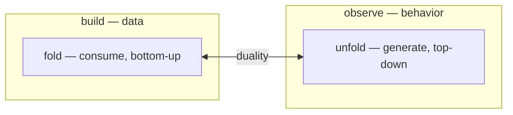

# Lapis — The Language, In One Document

> **Status:** Draft v0.1. This is the consolidated overview of Lapis's surface design: one document,
> sanity-checking the language end to end, and the seed for the marketing site. It is written
> example-first — every claim ends in a runnable block.
>
> This document is the **10,000ft view** — a gut-check on the syntax. The **normative production
> set** is the header of [`src/surface/grammar.ts`](../src/surface/grammar.ts): the executable
> grammar, whose `@rule` methods _are_ the productions. The authoritative specifications remain
> [`theory/surface-syntax.md`](./theory/surface-syntax.md) (syntax) and
> [`theory/semantics.md`](./theory/semantics.md) (meaning); each section links to its backing spec
> rather than duplicating it. Formal vocabulary (initial algebra, coalgebra, and friends) lives in
> those specs; this page keeps to plain language. Where this document and the code disagree on the
> _shape_ of the syntax, the code wins — and the findings in §12 record which questions the grammar
> still leaves open.
>
> Sources consolidated here: `surface-syntax.md`, `surface-grammar.md`, `syntax-design.md`,
> `semantics.md` §1, `users/rationale.md`, `users/why-lapis.md`, and the prototype's tests and
> examples ([lapis-js](https://github.com/lapis-lang/lapis-js)).

**Lapis is a programming language where you declare your data and its laws — and fold and unfold are
the only recursion you'll write.**

---

## 1. Why Lapis?

You declare algebraic laws — `associative`, `distributive` — and the compiler verifies them with
generated counterexamples, then _exploits_ them: fusing traversals, short-circuiting folds,
calculating the one-pass program from your two-pass specification. Horner's rule, applied by your
compiler, because it trusts your laws. That trust is earned structurally: the language has no
general recursion, so every program terminates by construction and every operation has a known
algebraic shape.

The full hook, with the Horner example worked end to end, is
[`users/why-lapis.md`](./users/why-lapis.md).

---

## 2. Starting Small: Declaring Data

### 2.1 An enumeration

Every Lapis program starts by declaring data. The smallest declaration is an enumeration — variants,
no fields:

```lapis
data Color
    Red
    Green
    Blue
```

The variants are values — singletons, ready to use:

```lapis
Color Red    /* the Red singleton */
```

That block is a **comment** — Lapis spells them `/* ... */`, with nesting: a comment spans lines or
trails an expression. The trailing example below records what an expression produces; a comment on
its own line describes the construct beneath it. The position is the meaning (details in
[spec §1.4](./theory/surface-syntax.md#14-comments)).

If you've written a Java `enum` or a Python `Enum`, this reads the same way. The difference is
what's underneath: there is no separate `enum` mechanism. This is the same `data` declaration every
other type uses, with the fields simply left out.

One more kind of member: a variant can be a **pattern** — a shape of text, every match of which is a
value of the type. Extending the declaration:

```lapis
data Color
    Red
    Green
    Blue
    #[0-9A-F]{6}
```

`Red` is constructed by name; the pattern needs no name — its spelling is its constructor:

```lapis
#1A2B3C             /* a Color — six hex digits after a '#' */
```

That is: when you write `#1A2B3C`, it's `Color`'s pattern that matched it. Your declaration added a
literal to the language.

### 2.2 Fields

Variants carry fields by naming them:

```lapis
data Point
    Point2D x: Int y: Int
    Point3D x: Int y: Int z: Int
```

Construction is prefix — the variant name, then the fields:

```lapis
Point2D x: 1 y: 2                  /* a Point2D */
Point3D x: 1 y: 2 z: 3             /* a Point3D */
```

Reading is symmetric — a field is read directly:

```lapis
somePoint x                        /* 1 */
somePoint y                        /* 2 */
```

Pattern constructors carry fields too — a **capture** (`<name: Type>`) names the slice of the match
that becomes a field:

```lapis
data Rational
    Ratio <p: Int>/<q: Int>

data Complex
    Cartesian <re: Float>+<im: Float>i
```

The declaration is the constructor — spell the shape, and the captures become fields:

```lapis
1/2                 /* a Rational — p is 1, q is 2 */
3.0+5.0i            /* a Complex — re is 3.0, im is 5.0 */
```

The capture's type gates its slice: `3+5i` is not a Complex, because `3` is not a `Float` under the
built-in patterns (§2.3) — the decimal point is required.

```lapis
(1/2) p             /* 1 */
(3.0+5.0i) im       /* 5.0 */
```

Whether a value came from a named variant or a pattern match, a field is a field — same reads, same
places.

No `new`, no constructor-overload gymnastics.

**No ambiguity with operations — position decides.** A pattern constructor is recognized only where
the lexer expects a value, and patterns are tried first there, longest match winning: `1/2` is one
token matching `Ratio`'s shape, while `1 / 2` — the spaces break the token — is `1`, then `/` in
infix position, then `2`: the division operation. The same characters build data in prefix position
and name operations between tokens. Two further rules keep the forms disjoint. A pattern's
leftmost-matchable set must exclude letters — computed from the pattern, not its spelling
(`[0-9]?[a-z]+` is rejected: the optional digit can be absent) — so no declared pattern can swallow
an identifier, keyword, or named variant. And a match is contiguous: whitespace is consumed only
where the pattern's structure includes it, which is why `"hello world"` is one String value (the
delimiters are part of the pattern) while `1 / 2` can never be a Rational.
([spec §1.3, §2.1](./theory/surface-syntax.md#13-pattern-matched-data-types))

### 2.3 The built-ins are data too

Where did `Int` come from, and why does `42` spell a number? §2.1 showed the trick without naming
it: the "built-in" types are ordinary `data` declarations whose constructors are **patterns**
([`theory/prelude.md`](./theory/prelude.md) §2 is the single definition site):

| Type     | Pattern(s)         | Example   |
| -------- | ------------------ | --------- |
| `Char`   | `'.'`              | `'a'`     |
| `String` | `"<Char>*"`        | `"hello"` |
| `Int`    | `-?[0-9]+`         | `42`      |
| `Float`  | `-?[0-9]*\.[0-9]+` | `3.14`    |

When you write `42`, it's `Int`'s pattern `-?[0-9]+` that matched it — the same move as `Color`'s
`#[0-9A-F]{6}`, just declared for you. The literal shapes a program recognizes are chosen by the
program, not the language. And the value spellings — `'a'` one character, `"hello"` a string — are
the same spellings every user declaration's literals take (§1.4's reservation rules keep the forms
disjoint from comments and from declared patterns). For the two quoted built-ins the delimiters are
part of the pattern — `'.'`, `"<Char>*"` — which is why the `'` and `"` heads are reserved: Char and
String own them, and no user pattern may match a string beginning with either.

`Bool` and `Nat` are the two built-ins declared with **named variants** instead of patterns; §3.1
has `Bool`'s, and `Nat` is the Peano carrier (`Zero`, `Succ pred: Family`) the law section's `add`
is declared over. A named carrier can be destructured by a fold's arms, which a pattern carrier
cannot — that is the whole reason both kinds exist.

### 2.4 Subtyping: extending a declared data

A data type can be declared as an **extension** of another, with `<:` ("is a"):

```lapis
data Point2
    Cartesian2 x: Int y: Int
    Polar2     r: Int theta: Int

data Point3 <: Point2
    Cartesian3 x: Int y: Int z: Int
    Polar3     r: Int theta: Int phi: Int
```

`Point3` is a new type whose variants are **the parent's variants plus its own**. The parent's
constructors work on the child — inherited variants construct through the child and belong to both
types:

```lapis
Point2 Cartesian2 x: 1 y: 2       /* a Point2 — as before */
Point3 Cartesian2 x: 1 y: 2       /* the same variant, built through the child — a Point3 AND a Point2 */
Point3 Cartesian3 x: 1 y: 2 z: 3  /* a new variant — and also a Point2 */
```

And the membership direction is asymmetric: every `Point3` is a `Point2` — wherever a `Point2` is
expected, any `Point3` may appear — but a plain `Point2` value is _not_ a `Point3`. Subtypes add;
they never widen.

Note what the subtyping is between: **types, not variants**. `Cartesian3` is a new variant of
`Point3` — it is not a subtype of `Cartesian2`, and no variant-to-variant subtype relation exists.
The two Cartesian variants simply share fields, the way siblings share a surname; what makes
`Point3 Cartesian3 x: 1 y: 2 z: 3` acceptable where a `Point2` is expected is `Point3 <: Point2`,
the whole declaration. (The reference model agrees: its `Point2D`/`Point3D` variants have no subtype
link between them either — new fields live in new variants.)

This is **comb inheritance** (NewtonScript-style): the child's variant set combines with the
parent's, down the whole chain. The name comes from the shape the two lookup paths make in the
reference model — a prototype chain (shared behavior, the comb's spine) plus a _parent_ chain
(instance-level delegation, the comb's teeth); in Lapis the teeth are the delegation links between a
child type's variants and their same-name parents down the chain. When anything is looked up on a
`Point3` value — a variant's fields, later an operation — the lookup first checks what `Point3`
declares, then delegates to `Point2` and repeats. Two consequences matter in practice:

**Variant narrowing.** A child may re-declare an inherited variant to sharpen what its fields _hold_
— provided every re-specified field type is a **subtype** of the parent's (covariant), and no new
fields appear:

```lapis
data List
    Nil
    Cons head: Any rest: Family

data IntList <: List
    Cons head: Int rest: Family
```

`IntList` re-declares `Cons` with `head: Int` — a narrowing of `List`'s `head: Any` (every `Int` is
an `Any`'s inhabitant, so the substitution holds). Unmentioned fields — `rest` here — are inherited
unchanged; introducing a field the parent doesn't have is rejected.

And `Family` — "the rest of the type being declared" (introduced properly in §2.5) — is what makes
these extensions possible at all. A `Family`-typed field means "any future subtype's rest" — that's
**open recursion**. The by-name spelling (`rest: IntList`) closes it — exactly `IntList`, no subtype
welcome. Same text, two recursion disciplines, chosen per field:

| Spelling        | Recursion | Subtypes                           |
| --------------- | --------- | ---------------------------------- |
| `rest: Family`  | open      | welcome — richer variants extend   |
| `rest: IntList` | closed    | none — the value is one fixed type |

`<:` is the whole subtyping story for data: more variants, narrower fields. No interfaces, no
abstract classes, no cast operators — a declaration that names a parent, and the chain does the
rest. ([spec §4.1](./theory/surface-syntax.md#4-declaration-formats))

Everything a `Point2` can be asked, a `Point3` can answer — that's the promise `<:` makes, and §3
shows how the language keeps it.

### 2.5 Recursion

A field's type is any type in scope — including the one being declared. Two spellings for the
self-reference, same meaning:

```lapis
data IntList
    Nil
    Cons head: Int rest: IntList    /* by name — if IntList is in scope */
```

And a field can reference "the rest of the type being declared" positionally with `Family`:

```lapis
data IntList
    Nil
    Cons head: Int rest: Family      /* same meaning, no name needed */
```

`Family` is the spelling that works _before_ the type's own name could resolve — mutually recursive
declarations, or just not wanting to repeat the name. §2.4 already met `Family`'s second job: a
`Family`-typed field keeps the recursion **open** — any future subtype's rest may fill it — while
the by-name spelling closes it: `rest: IntList` means exactly `IntList`, no more, no less (the whole
value is always one fixed type).

`Nil` is the empty list; `Cons` carries a head and the rest. Values are built by chaining:

```lapis
IntList Cons head: 1 rest: (IntList Cons head: 2 rest: IntList Nil)
```

```lapis
Cons head: 1 rest: (Cons head: 2 rest: Nil)
```

The `IntList` qualifiers are optional — both spellings are legal, bare by default; the qualifier
earns its keep only when `Cons` or `Nil` would be ambiguous in scope (another in-scope type
declaring the same variant name).

That's an algebraic data type — the thing behind sealed-interface hierarchies and dataclass unions —
— in seven lines, with recursion spelled either `rest: IntList` or `rest: Family`.
([spec §4.1](./theory/surface-syntax.md#4-declaration-formats))

### 2.6 The lattice's bounds: `Any` and `Nothing`

Every type so far has been a `data` you declared. Two more complete the type universe — its bounds:

- **`Any`** — the top. Every value is an `Any`, with no declaration needed. A field typed `Any`
  accepts anything:

  ```lapis
  data Box
      Wrap value: Any     /* accepts strings, numbers, any declared type's values */
  ```

- **`Nothing`** — the bottom. It has **no values** — no constructor can produce one, no pattern can
  match one. Its use is at elimination: a fold whose `out` is `Nothing` can never return, so
  declaring one is a compile-time-checked way of saying "this case is impossible". And the compiler
  trusts it: code after a `Nothing` result is unreachable by construction.

The pair does for the whole language what it does in any lattice: `Nothing <: X <: Any` for every
type `X` — implicitly, with no `[<: Any]` ceremony (every type is already a subtype; writing it
would be redundant and is rejected). Subtyping's rules from §2.4 stay put: extension adds variants,
narrowing sharpens fields — the bounds just anchor the ends.

That the spellings are available in every module is a separate claim, and it depends on the module
design (§5.3): under the ban on imports there is no global namespace, so the primordials — these
bounds, and §2.3's built-ins — are placed by decision, not assumed ambient. The bounds argue for a
small language-fixed set (a namespace without `Any`/`Nothing` breaks the lattice every type
participates in); the spec must pin it (§12.24).

### 2.7 Many types at once

Real domains have several types that reference each other. Two moves cover it:

**Mutual recursion.** Two types can reference each other — the compiler resolves the whole
declaration set together, so declaration order doesn't matter:

```lapis
data Expr
    Lit value: Int
    BlockExpr stmt: Stmt body: Family  /* references Stmt — not yet declared */

data Stmt
    Assign name: String value: Int
    Seq first: Family second: Family   /* Family = this type's rest — no name needed */
```

**Sorts.** A field's type can be _another_ declared type, and construction enforces it — values of
the wrong sort are rejected at construction:

```lapis
Point2D x: 1 y: 2                 /* a Point — fine */
Expr Lit value: Point2D x: 1 y: 2 /* rejected — a Point is not an Int */
```

That's the whole mechanism: each type is its own declaration, cross-references are ordinary field
types, and construction-time checks keep the sorts straight. No shared namespace, no coordination
between declarations — the same `data` form throughout.
([spec §4.1](./theory/surface-syntax.md#4-declaration-formats))

---

## 3. Doing Things With Data

### 3.1 Fold: reading a data value

Operations are declared **inside** the data declaration. A `fold` has one case arm per variant, and
each arm replaces the constructor with an operation:

```lapis
data IntList
    Nil
    Cons head: Int rest: Family

    fold sum <out: Int>
        Nil -> 0
        Cons head rest -> head + rest
```

Using it is the same shape — name the operation, pass the value:

```lapis
xs sum              /* 3 */
```

This is the _only_ way to consume an `IntList` — and that's the point. Every consumer of a data type
has the same shape, so the compiler knows the shape of every operation you write.
([spec §5.1](./theory/surface-syntax.md#5-foldunfoldmapmerge-declarations))

**One shape, several options.** The plain fold above is the base member of a small family — every
option changes exactly one thing about the traversal, and the whole family stays bottom-up and
total:

| Option         | What it adds                                                       | Classic name  |
| -------------- | ------------------------------------------------------------------ | ------------- |
| plain fold     | one arm per variant; recursive fields arrive **already folded**    | catamorphism  |
| parameterized  | `<in: …>` — one input threaded through the whole traversal         | —             |
| `old`          | the arm also sees the original sub-value, **before** folding       | paramorphism  |
| `prev`         | look **deeper** than the immediate sub-result                      | histomorphism |
| `aux`          | a companion fold's results ride the same traversal                 | zygomorphism  |
| `scan`         | the fold's result at _every_ subterm, root-first                   | scan lemma    |
| `_` (wildcard) | one arm that catches whatever the others don't — open variant sets | —             |

A **parameterized fold** carries one input — here, an element to append. The spec carries only the
type (`in: Int`); the arm names the input with a binding after the variant's fields:

```lapis
fold append <in: Int, out: Family>
    Nil in -> Cons head: in rest: Nil
    Cons head rest in -> Cons head: head rest: (rest append: in)
```

**The carrier is not that binding.** `append` is declared inside `data List`, so its first argument
is the list; `in` names the _second_ argument, the `in:` value. The elaborated definition is
therefore `λe:List. λ<n>:Int. fold_List e {…}`, and that binding is a lambda binding, not a handler
binding — bindings beyond `Cons`'s two fields never enter the handler's positional list. A fold
without `in:` (`fold size <out: Int>`) has the carrier alone, so its arms bind only fields.

**The field bindings spell their fields' names.** An arm head is a pattern, so `Cons head rest in`
names `Cons`'s declared `head` and `rest` and then the parameter; `Cons h r in` would be rejected.
`in` itself has no declaration to agree with, so the language fixes that one word.

At most one `in:` is legal: an operation takes the receiver and one `in:` value, so the arity is one
or two and a second `in:` is rejected rather than silently dropped. The type gates the call site
(`xs append: 3`). Recursive positions arrive as partially-applied continuations: give the input and
the traversal continues:

```lapis
xs append: 3      /* with input — called as a method; without input, read as a property */
```

An **auxiliary fold** fuses a companion computation into the traversal — checking balance needs each
node's depth, but that's a second pass unless `aux` rides along:

```lapis
fold depth <out: Int>
    Leaf -> 0
    Node left right -> 1 + (left max right)

fold balanced <aux: #depth, out: Bool>
    Leaf -> true
    Node left right -> (left and right) and (1 = (abs (depth left - depth right)))
```

`old` shows up with contracts in §6.2; `prev` is how `fib` reaches two levels back — the result one
level below the immediate child; `scan` turns one fold into _all_ the partial results
(`[6, 5, 3,
0]` for `[1, 2, 3]` under `sum`). And the wildcard `_` arm keeps the fold total over
open variant sets — the piece that lets §2.4's subtypes extend a parent's operation with arms for
only their new variants: inherited variants keep the parent's arms, new variants supply theirs, and
the fold stays exhaustive over the combined member set. That is how the language keeps §2.4's
promise — everything a `Point2` can be asked, a `Point3` can answer.

### 3.2 Unfold: generating data

The dual. Where `fold` consumes a finished value, `unfold` builds one up from a seed. Like every
operation, it is declared **inside** the data declaration — one arm per variant, each arm deciding
whether the seed produces that variant, and what the next seed is:

```lapis
data IntList
    Nil
    Cons head: Int rest: Family

    unfold Range <in: Int>
        Nil n -> n = 0
        Cons n -> n > 0 | head: n rest: n - 1

IntList Range: 3      /* Cons 3 (Cons 2 (Cons 1 Nil)) — a list, built from a number */
```

A generator arm is a **guard | payload**: the guard decides whether the arm applies; when it holds,
the arm produces the variant named in the arm head, with the fields the payload supplies. Otherwise
it declines and the next arm is tried — the first arm whose guard holds wins (the prototype's shape:
a handler returns either a fields object or `null`, and the first non-null one decides).

The payload is a **target-typed construction**: the variant is not repeated, because the arm head
already names it. (C#'s target-typed `new` is the same move — the target comes from context, so the
name is omitted.) The payload spells only the fields, as a keyword message — `head: n rest: n - 1` —
the Smalltalk shape; the field names are _labels_ there, not bindings, so `n` is still the seed. The
payload is required exactly when the arm's variant has fields: the base arm carries none, because
`Nil` has no fields and there is nothing to say.

One wrinkle: in a recursive field, the value is not a built value but the **next seed** —
`rest: n - 1` says "the rest of this list is whatever unfolding the seed `n - 1` produces", not "the
rest is the number `n - 1`". (The prototype draws the same line: for a recursive field, the returned
value becomes the seed for the recursive unfolding.)

So the arms read as a decision table over the seed: `n = 0` produces `Nil` (the base — generation
stops); `n > 0` produces a `Cons` carrying `n`, with the rest seeded by `n - 1`. The recursion is
the seed shrinking — the same totality argument §2.5's fold runs, in reverse. This is the DSL's
`List.Range` — the workhorse that turns a number into a list — and it is an ordinary member of the
`data` declaration, exactly where `sum` sat in §3.1.

The same declaration shape serves the other extreme: a `behavior`, the type you observe rather than
construct, generates potentially endless structure:

```lapis
behavior Stream
    head: <out: Int>
    tail: <out: Self>

    unfold From <in: Int>
        head n -> n
        next n -> n + 1

Stream From: 0
        /* observe: head 0, tail head 1 */
```

Same declaration shape as `data`, arrows reversed. A stream is observed one step at a time and never
stored — potentially endless, always productive.

Observers can take input too, and one behavior can offer several generators:

```lapis
behavior Stream
    head: <out: Int>
    tail: <out: Self>
    nth:  <in: Int, out: Int>       /* the i-th observation */

    unfold From <in: Int>
        head n -> n
        next n -> n + 1
        nth n i -> (n + i)

    unfold Fibonacci <in: (a: Int, b: Int)>
        head pair -> pair a
        next pair -> (a: pair b, b: (pair a + pair b))

Stream Fibonacci: (a: 0, b: 1)      /* 0, 1, 1, 2, 3, 5, ... */
```

Lazy by construction: each observation is computed on demand — `head` when you read it, the next
instance when you step to it (and it's the _same_ instance each time — a continuation is memoized).
Nothing is computed until observed, so an infinite tree is as cheap to name as a finite one: the two
children of an infinite tree are two more unfolds. Potentially endless, always productive.
([spec §4.2, §5.2](./theory/surface-syntax.md#4-declaration-formats))

### 3.3 Merge — one pass instead of two

Unfold builds the structure; fold tears it down. `merge` fuses them into **one traversal** — the
intermediate structure is never built:

```lapis
data IntList
    Nil
    Cons head: Int rest: Family

    fold sum <out: Int>
        Nil -> 0
        Cons head rest -> head + rest

    unfold From <in: Int>
        Nil n -> n = 0
        Cons n -> n > 0 | head: n rest: n - 1

    merge Total <#From, #sum>

IntList Total: 5    /* 15 — one pass, no list materialized */
```

You wrote the two-pass specification (generate a list of descending numbers, then sum it). The
language calculated the one-pass program. Factorial is the classic: generate-and-count fused is
factorial, with no list ever allocated.
([spec §5.4](./theory/surface-syntax.md#54-merge-declaration))

### 3.4 Map

Map transforms each field position; all other structure is preserved by construction:

```lapis
map scaleEach <in: Int, out: Family>
    Nil x -> Family Nil
    Cons head rest x -> Family Cons head: head * x rest: (rest scaleEach: x)
```

A map can also be declared as the **inverse** of another — one side states the relationship, the
other is derived, and the compiler enforces the pair is one-to-one:

```lapis
map toCelsius <out: Family>
    Cons head rest -> Family Cons head: (head - 32) * 5 / 9 rest: rest

map toFahrenheit <out: Family, inverse: #toCelsius>
    Cons head rest -> Family Cons head: head * 9 / 5 + 32 rest: rest

readings toFahrenheit toCelsius      /* back where you started — round-trip is identity */
```

([spec §5.3](./theory/surface-syntax.md#53-map-declaration))

### 3.5 Scan: all the partial results at once

Sometimes one final answer isn't enough — you want the fold's answer at every stopping point. A
`scan` applies an existing fold to the whole value _and_ to every subterm, all in one pass:

```lapis
scan cumulative <#sum>

xs sum                 /* 6 */
xs cumulative          /* [6, 5, 3, 0] — the total, then each tail's sum */
```

The last element is always the fold of the empty base (`0` here); the first is the whole structure's
fold. It works on trees too — every subtree's sum, root first. This is the datatype-generic version
of what Haskell calls `scanr`, and it falls out of the fold discipline for free: the traversal was
already there; scan just keeps the intermediate results instead of discarding them.

**Aliases.** Any operation can carry extra names — same operation, spelled differently where the
domain says so:

```lapis
fold meet <in: Self, out: Self>
    ... aliases (and)
```

`xs meet ys` and `xs and ys` are the same operation. Aliases keep the algebraic name (`meet`,
`join`) and the programmer's shorthand (`and`, `or`) from fighting over spelling.

---

## 4. The Idea Underneath: Duality

Read §2–§3 again and you'll see it: every concept came in a pair, the second member the first seen
in reverse. Build ↔ observe. Consume ↔ generate. That's **duality** — and its payoff is practical:
learn one side and you already know the other, and a fact about one side is a fact about the other
for free. Lapis doesn't just borrow the idea — it makes it the syntax. The keywords themselves come
in dual pairs.

### 4.1 Fold is universal

`fold` being the only way to consume data isn't a limitation — it's a theorem. Every total function
on a data type that respects its structure _is_ a fold: `sum`, `length`, `map`, `filter`, `reverse`
are all the same shape with different constructors replaced.

> _Formally:_ a data type is the initial algebra of its shape functor, and fold is the unique
> homomorphism out of it ([`theory/semantics.md`](./theory/semantics.md)).

### 4.2 Unfold is its dual

Where fold is the universal _consumer_, unfold is the universal _producer_: from a seed, a step
function either stops or produces a value and a new seed. Fold consumes finite structure bottom-up;
unfold generates potentially infinite structure top-down. Together they are the two fundamental
activities — **consuming** and **generating**.

### 4.3 The duality of semantics

The pair does real work at the level of the language itself: **what a program _means_ is a fold over
its syntax; how it _runs_ is an unfold from its state.** For most languages that's a description in
a graduate textbook. Lapis takes it as a syntax decision:

> _Formally:_ denotational semantics is structured by fold, operational semantics by unfold — see
> [`theory/semantics.md`](./theory/semantics.md) §1.

| Build                                     | Observe                                                  |
| ----------------------------------------- | -------------------------------------------------------- |
| `data` — declare how things are built     | `behavior` — declare how things are observed             |
| `fold` — consume, finite, always finishes | `unfold` — generate, possibly endless, always productive |
| `relation` — compute everything reachable | `query` — explore outward from a seed                    |
| `Family` — "the rest of this data"        | `Self` — "the rest of this behavior"                     |
| reason from how things are built          | reason from what you can observe                         |



### 4.4 Four payoffs, one idea

The duality earns its keep four ways, each landing on a concrete Lapis feature:

| Payoff             | In Lapis                                                                                                                       |
| ------------------ | ------------------------------------------------------------------------------------------------------------------------------ |
| **Transfer**       | Declare a law once; it holds however the structure is traversed.                                                               |
| **Simplification** | `merge` — fusion by construction, the intermediate structure never exists.                                                     |
| **Certification**  | Every program finishes — totality by construction; laws are checked before the program runs, with a counterexample on failure. |
| **Discovery**      | `query` is just `relation` seen from the other side.                                                                           |

---

## 5. The Other Declaration Pairs

### 5.1 Relation ↔ Query

A `relation` is a data type with two distinguished folds — `origin` and `destination` — that project
each variant to its endpoints. Its dual, `query`, is a behavior type whose observers split into
three roles: what to output, when you're done, and whether the result is accepted. Where
`relation`'s closure computes everything reachable, `query`'s `explore` walks outward from a seed.

```lapis
relation Ancestor
    Direct from: String to: String
    Transitive hop: Family rest: Family

    fold origin <out: String>
        Direct from _ -> from
        Transitive hop _ -> hop

    fold destination <out: String>
        Direct _ to -> to
        Transitive _ rest -> rest
```

```lapis
Ancestor closure: base                       /* everything reachable from the base facts */
Ancestor reachableFrom: closed from: "alice"
```

That's Datalog's reachability, as an ordinary declaration. And `query` is the same idea reversed:
closing over facts computes everything reachable; exploring from a seed walks the paths themselves.
([spec §4.4–4.5](./theory/surface-syntax.md#4-declaration-formats))

Two things come free with the pair, because they're derived from the declarations:

- **The join invariant is auto-generated.** For recursive variants with two endpoint-typed fields,
  the compiler derives `first destination = second origin` — composition — and enforces it at
  construction. You never write it; you couldn't get it wrong if you tried.
- **Cycles are handled.** The closure deduplicates by endpoint pair (Datalog's flat-tuple
  semantics), so cyclic graphs terminate — the derivation may be infinite, the reachable set isn't.

And each operation means something specific on proofs: a relation instance _is_ a proof witness —
`Direct` is an axiom, `Transitive` is a derivation step — so `fold` reads a proof, `unfold` writes
one, `map` re-labels it, `merge` fuses reading and writing. When to use which side: enumerate
_everything_ reachable, use `relation` (bottom-up, complete); answer one query lazily or control the
search, use `query` (top-down, stops when it has enough).

### 5.2 IO — a state machine

Side effects are declared the way you'd draw one: state fields, plus steps that return the next
state and an output — in the same declaration language as everything else:

```lapis
io Prompt
    count: Int
    Tick n -> (state: (n + 1), output: n)
```

([spec §4.6](./theory/surface-syntax.md#4-declaration-formats))

### 5.3 Modules — dependencies as values

Types compose into programs through modules — and a module is a _value_: a function from its
dependencies to its exports. Nothing is resolved through global imports; dependencies arrive
explicitly at instantiation:

```lapis
module Lists (T: Type)
    List:  data Nil / Cons head: T rest: Family
    IntList: data Nil / Cons head: Int rest: Family

Lists Num:    /* an instance — its own fresh types */
Lists String: /* another instance — independent */
```

A module can **extend** another: the child's exports layer on top of the parent's (child keys
override parent keys), and the chain resolves root-first:

```lapis
module Collections extends Lists
    Stack: data Empty / Push value: T rest: Family
```

Contracts work on modules like everything else — `demands` on dependencies, `ensures` on exports,
checked at instantiation. And a program is one module wiring others together: `system` composes
module instances and hands the result to the runtime — the IO machine of §5.2 runs it.

---

## 6. Systematic Consequences

These aren't bolted-on features — they fall out of the fold/unfold discipline.

### 6.1 Laws: declared, verified, exploited

Properties live in the fold's spec record. The compiler verifies them against generated samples
(`LawError` with a counterexample, before the program runs) and exploits them two ways: at `merge`
time (fusion) and at **call time** (short-circuit guards):

```lapis
data Num
    N value: Int

    fold add <in: Self, out: Self, properties: (commutative, associative, identity: (Num N: 0))>
        N value -> Num N: value + in value

    fold multiply <in: Self, out: Self, properties: (distributive: #add)>
        N value -> Num N: value * in value
```

Declare `distributive`, and fusion — Horner's rule — is the compiler's job, not yours. Declare
`identity`, and `x add (Num N: 0)` never even enters the fold — the guard returns `x` itself, by
reference, after a single equality check. `absorbing` and `idempotent` get the same treatment: the
laws aren't just checked, they're _used_. ([details](./users/why-lapis.md),
[law testing](./theory/law-testing.md))

### 6.2 Contracts: demands, ensures, invariant, rescue

Contract clauses are keyword parts of the fold spec — preconditions checked before the fold runs,
postconditions with `old` snapshots, structured recovery:

```lapis
fold pop <out: List>
    demands: self | self size > 0
    ensures: self old result | result size = old size - 1
    Empty -> Error signal: "Cannot pop empty stack"
    Push value rest -> value , old rest
```

([spec §5.1](./theory/surface-syntax.md#5-foldunfoldmapmerge-declarations))

### 6.3 Protocols: operations a type must provide

A `protocol` declares operations that conforming types must provide; `satisfies:` asserts
conformance, verified structurally. A member is a kind-marked signature, and an indented body
supplies a default that conforming types inherit when they don't declare the operation themselves:

```lapis
protocol Ordered
    fold compare <in: Self, out: Int>
    fold lessThan <in: Self, out: Bool>
        (self compare: in) < 0

data Num
    N value: Int

    satisfies: Ordered
    fold compare <in: Self, out: Int>
        N value -> value - in value
```

A default body composes operations over `self` and may read the `in:` value as `in` — it can't
dispatch on a variant, because a protocol never sees its conformers' variants. Only `fold` and `map`
members take a default.

([spec §4.3](./theory/surface-syntax.md#43-protocol---qualified-type))

### 6.4 Invariants on variants

Contracts live on folds (§6.2) — and on variants, where they constrain _relationships between
fields_, beyond what individual field types can say:

```lapis
data Range
    CharRange invariant: (start <= end)
        start: Char
        end: Char
```

Checked at construction — `CharRange start: 'z' end: 'a'` is rejected before any fold sees it.

---

## 7. The Syntax Itself

### 7.1 Your declarations are your lexer

§2.3 showed the trick without naming it: the "built-in" types are ordinary `data` declarations, and
their pattern constructors are **lexical rules** — the lexer is driven by the `data` declarations in
scope, so the set of literal shapes in a program is chosen by the program.

The pattern language is a flat regular fragment (no alternation, no groups — decompose with variants
instead), compiled to a fast table-driven matcher, capped at 80 source characters and 80 consumed
characters — hygiene bounds, stated loudly at the edges.
([spec §1.3](./theory/surface-syntax.md#13-pattern-matched-data-types))

### 7.2 Three precedence levels — no ladder

Three levels, strictly ordered (unary > binary > keyword); **no precedence ladder within binary
operators**. All binary operators name folds, evaluated left-to-right:

```lapis
1 + 2 * 3           /* 9 — parses as (1 + 2) * 3 */
1 + (2 * 3)         /* 7 — explicit parentheses for mathematical grouping */
xs append: 3        /* keyword form: multi-argument */
Color Red toHex     /* unary chains: left to right */
```

No table of seventeen precedence levels to memorize. If grouping matters, say so.
([spec §2](./theory/surface-syntax.md#2-expression-precedence))

**Reads follow the uniform access principle.** An operation without input is read as a property;
with input, it's called:

```lapis
Color Red toHex       /* property — parameterless fold */
xs append: 3          /* method — the fold carries an input */
```

No `()` vs property distinction to remember per operation: the declaration's shape decides, and it
reads the same everywhere.

### 7.3 Layout

Significant indentation, fixed 4-space unit, declaration bodies and case tables shaped by columns.
Newlines separate body lines; case arms may be inline or indented:

```lapis
data Color
    Red
    Green
    Blue
    #[0-9A-F]{6}
```

Comments follow the same layout logic: a comment on its own line describes the construct beneath it
(forward association); a comment trailing an expression records that expression's result. Blank
lines separate the groups — a reader-facing style rule, never a grammar rule: reformatting blank
lines can never change which construct a comment describes.
([spec §6](./theory/surface-syntax.md#6-indentation-strategy))

### 7.4 Naming conventions — the position tells you the case

Names carry their role in their case, checked at declaration:

| Role                          | Convention         | Example           |
| ----------------------------- | ------------------ | ----------------- |
| Type, variant, unfold         | PascalCase         | `NatList`, `Cons` |
| Field, fold, map, alias       | camelCase          | `head`, `sum`     |
| Keyword-part references (`#`) | the name it quotes | `#sum`            |

No `I`-prefixes, no `_` prefixes, no Hungarian — the case _is_ the convention, and the compiler
enforces it. (`scan` names follow folds; `merge` names follow their composition — PascalCase when
the pipeline starts with an unfold, camelCase otherwise.)

---

## 8. The Whole Thing At Once

```lapis
data Stack
    Empty
    Push value: Any rest: Family

    fold size <out: Int>
        Empty -> 0
        Push _ rest -> 1 + rest

    fold peek
        Empty -> nil
        Push value -> value

    fold pop <para>
        Empty -> nil
        Push value rest -> value , old rest

    unfold FromArray <in: List>
        Empty arr -> arr isEmpty
        Push arr -> arr notEmpty | value: arr first rest: arr tail
```

Note `pop`'s `<para>`: it makes `old` available — the original sub-value _before_ folding, for
handlers that need both the transformed and the untouched piece. `prev` and `aux` similarly expose
two other common shapes (previous results, auxiliary results) as keywords, not libraries.
([spec §7](./theory/surface-syntax.md#7-special-references-in-expressions))

---

## 9. The Language in 19 Keywords

| Keyword     | Purpose                                             |
| ----------- | --------------------------------------------------- |
| `data`      | Declare a type by how its values are built          |
| `<:`        | Declare a type as an extension of another (§2.4)    |
| `behavior`  | Declare a type by how its values are observed       |
| `protocol`  | Declare operations a type must provide              |
| `relation`  | Declare linked data with two endpoints              |
| `query`     | Declare a search over generated states              |
| `io`        | Declare a state machine for side effects            |
| `fold`      | Consume a data value                                |
| `unfold`    | Generate values from a seed                         |
| `map`       | Transform fields, structure preserved               |
| `merge`     | Fuse generate + consume into one pass               |
| `satisfies` | Assert a type meets a protocol                      |
| `not`       | Negation on `Bool` (prefix)                         |
| `self`      | The current instance (always in scope)              |
| `Family`    | "The rest of this data" — recursion in data         |
| `Self`      | "The rest of this behavior" — recursion in behavior |
| `old`       | The original sub-value, before folding              |
| `prev`      | The previous fold's result                          |
| `aux`       | An auxiliary fold's result                          |

Plus `nil`, `true`, `false`. That is the entire reserved-word list.

There is no binding former — no `let`, no `in`, no definition keyword. `let x:σ = t in u` exists in
the core calculus as a term, but it is not surface syntax; the surface introduces names only by
declaration (§12.6). One subtlety: `#` is not a keyword and `#name` is not a value — it is a
keyword-part _reference_ (§7.4), resolved against declared names at declaration time (`aux: #depth`,
`merge Total <#From, #sum>`).

---

## 10. What We Left Out, On Purpose

- **No base types.** `Int`, `String`, `Bool` are ordinary `data` types you could have declared
  yourself. Uniformity is what makes laws checkable over _all_ types.
- **No general recursion.** No `fix`, no `while`, no self-call. Totality by construction — no
  termination checker, no fuel monad.
- **No operator precedence ladder.** Uniform binary precedence; parentheses when grouping matters.
- **No alternation inside patterns.** Multiple variants are the decomposition tool — and keep
  patterns compilable to fast table-driven matchers.
- **No `let`-generalization, no polymorphic recursion.** The grammar-native typing is what lets the
  compiler trust the fold shape it is given.

Each restriction _enables_ the payoffs in §4.4. The restriction is the feature.

---

## 11. Where to Read More

| Want…                                      | Read                                                     |
| ------------------------------------------ | -------------------------------------------------------- |
| The hook, in five minutes                  | [`users/why-lapis.md`](./users/why-lapis.md)             |
| The full narrative journey                 | [`users/rationale.md`](./users/rationale.md)             |
| The complete syntax specification          | [`theory/surface-syntax.md`](./theory/surface-syntax.md) |
| The formal semantics (the duality at work) | [`theory/semantics.md`](./theory/semantics.md)           |
| The living prototype                       | [lapis-js](https://github.com/lapis-lang/lapis-js)       |

---

## 12. Sanity-Check Findings (frictions found while drafting)

This document doubles as the transliteration exercise: every example above was rewritten from the
prototype's tests/examples or the spec. Places where the transliteration felt underdetermined — each
is a real finding for the spec:

1. **Unfold use-site syntax is not pinned.** §8 of `surface-syntax.md` shows `unfold FromArray`
   declared but never called. This draft assumes constructor-position application
   (`NatList From: 5`, `Stream From: 0`), mirroring named-variant application. The spec should state
   it.
2. **The generator arm's shape — decided in this pass, to be pinned in §5.2.** The arm is
   `guard | payload`: when the guard holds, the arm produces the variant named in the arm head, with
   the fields the payload supplies; otherwise it declines and the next arm is tried (the prototype's
   shape — a handler returns either a fields object or `null`, and the first non-null handler
   decides). Three sub-decisions came out of the review. **(a) The payload is a target-typed
   construction.** The arm head already names the variant, so the payload must not repeat it — the
   move C#'s target-typed `new` makes (the target comes from context, so the name is omitted). The
   payload spells only the fields, as a keyword message — `head: n rest: n - 1` — the Smalltalk
   shape; the field names are _labels_ there, not bindings, so `n` is still the seed. Two earlier
   drafts were rejected: a record literal (`(head: n, rest: (n - 1))`) gives the language a _second_
   way to spell fields (record literals are for named-argument construction and specs, §3.3), and
   repeating the variant name (`Cons head: n rest: n - 1`) is redundant against the arm head. The
   payload is required exactly when the arm's variant has fields; the base arm carries none
   (`Nil n -> n = 0`), because `Nil` has no fields and there is nothing to say. **(b) A recursive
   field's value is the next seed, not a value.** `rest: n - 1` does not build a list; it says "the
   rest is whatever unfolding the seed `n - 1` produces" — the prototype draws the same line (for a
   recursive field, the returned value becomes the seed for the recursive unfolding). The spec must
   pin this reading of the recursive slot and say how it is checked (the seed is an `Int`, not a
   `NatList`). **(c) The separator.** `|` follows the binding-head convention (a block literal's
   `params | expr` head, since retired, §12.27) rather than inventing a token, and the arm body is
   its own restricted production — so `|` there is the separator, not the binary operator `|` (§2.1
   lists `|` among the symbolic operator names; the spec must either reserve it for this role or
   pick another separator — `=>` is the obvious alternative). A guard may not contain a top-level
   `|` under the restricted production. A fourth question the review raised and left open: **the
   payload's keyword-message form collides with the keyword-call production** —
   `head: n rest: n - 1` reads as a keyword _send_ (`head:` with argument `n`), and §2.3's keyword
   messages are collected greedily, so the arm body needs its own restricted production to keep
   `head:`/`rest:` as labels rather than a send. Spec impact: `surface-syntax.md` §5.2 (the
   generator-arm production — guard, separator, target-typed payload — and the seed reading of
   recursive fields), §2.1 (`|` reserved as a separator rather than an operator name), §2.3 (the
   keyword-message form vs the payload's labels), and §4.1 (the `data` declaration's unfold body).
3. **`map`'s relation to law-carrying folds is unsettled.** §5.3 specifies `map` as a single-line
   block transform; but `users/why-lapis.md`'s Horner example models `scaleEach` as a _fold_ with
   per-variant arms carrying `properties: (distributive: #sum)`. Which is canonical for "transform
   each element" — and can a `map` carry laws? The overview uses the §5.3 form; the spec should
   reconcile.
4. **User-defined pattern types lack a declaration form.** §1.3 says user types declare their own
   patterns (prose: `IntPat = -?[0-9]+`), but no `data`-level syntax is pinned for it. This overview
   now _teaches_ a concrete form (§2.1): a `data` declaration mixing named variants and pattern
   members (`data Color: Red Green Blue #[0-9A-F]{6}`), which is exactly the mixed-carrier surface
   spelling in PBI #80's scope (tentative there, incl. the lexing syntax). The spec must pin it —
   this document's first example now depends on it.
5. **`io` steps have no dual shown.** §4.6 gives the state-machine form; the overview's IO section
   is the first user-facing example. Whether `io` deserves a paired construct (its observe-side
   dual) is an open design question.
6. **Top-level value definitions — CLOSED: there is no definition form, at the top level or in any
   body.** The grammar has no `name = expr`, and `=` is an equality _operator_ (a declared fold
   name), so a definition spelling would also reintroduce the uniform-precedence footgun
   (`x = y + 1` grouping as `(x = y) + 1`). A program's top level is `declaration*` — no expression
   statements. Names are **declared, never bound**: a zero-field variant introduces a value; an
   operation declaration introduces a named computation, which is what lets it carry a declared
   type, a law set, and a cost summary. The `s = Stack Push ...` fragments this document and
   `surface-syntax.md` §8 used to show are documentation-fragment devices, now respelled as bare
   expressions with trailing result comments. The arm-level question was settled in the same
   decision: no `let … in`, no `::=`/`:=` header, no initialised-slot block, no default-valued block
   parameter — an intermediate an arm needs is a declared sibling operation (or `<aux: …>`), which
   is strictly stronger. Design record: `design-decisions.md` §"Program shape and name
   introduction"; worked case: `examples/quadratic.lapis` (the quadratic formula's discriminant).
   Spec impact: `src/surface/grammar.ts` (the `topExpr` production deleted), `surface-syntax.md` §8.

7. **Variant qualification at construction — reframed while drafting: qualification is
   disambiguation, for both constructor kinds.** The first draft flagged the asymmetry
   (`Point Point2D x: 1 y: 2` qualified at construction, yet fold arms resolve the same variants
   bare — `Cons head rest -> ...` — and the elaborator even drops the qualifier, `elaboration.md`
   §2.7: `Point Point2D x: 3 y: 4` → `Point2D(3, 4)`). The resolution this overview takes: **both
   spellings are legal, bare by default, qualified when needed to resolve ambiguity** — uniformly
   across the two constructor kinds:

   - **Pattern constructors.** `42` is bare when exactly one in-scope `data` declaration's pattern
     matches it. But `Int` and `Float` may each declare patterns that match `42` — then bare `42` is
     ambiguous and `Int 42` resolves it. So patterns _do_ get a qualification form (via their type
     name, standing in for the anonymous constructor), closing the earlier "patterns have no names
     to qualify" claim.
   - **Named variants.** `Point2D x: 1 y: 2` is bare when the variant name is unique in scope; the
     type prefix (`Point Point2D ...`) is required only when two types declare colliding names — the
     same rule the grammar already applies to fold arms, which resolve variants bare today.
   - **One principle, both kinds:** the qualifier names the _type_ whose constructor is meant; it is
     optional exactly when name/pattern resolution is unique in scope. If `Int` were the only number
     type in scope, `42` would need no qualification — and likewise `Point2D x: 1
     y: 2` needs
     none unless another type also declares `Point2D`.

   The elaborator already drops the qualifier (so bare-default costs nothing in the core); the spec
   needs to state the uniqueness rule and pin the ambiguity diagnostic ("ambiguous: `42` matches
   both `Int` and `Float` — qualify").

   One gap the uniqueness rule does not cover: **bare construction of an inherited variant.** §2.4's
   `Point3 Cartesian2 x: 1 y: 2` is not disambiguation — the variant name is unique (declared in
   `Point2`, inherited into `Point3`'s member set); the qualifier selects the constructing type,
   which decides membership (a Point3 AND a Point2, vs a plain Point2). What bare `Cartesian2 …`
   means there is unpinned, and the candidates disagree: the declaring type (bare is a plain Point2,
   line 1's qualifier optional) vs the most specific in-scope type whose member set includes the
   variant (bare is a Point3 AND a Point2 — line 1's qualifier load-bearing, the only spelling of a
   plain Point2). §2.5's chained example, §3.1's append arms, and §8's construction are now spelled
   bare — safe there, since no extension is in scope and bare is unambiguous under every candidate.
   Spec impact adds: the bare constructing-type default for inherited variants, and the qualifier's
   reach (any type whose member set includes the variant).

8. **Pattern captures are load-bearing but un-owned in the backlog.** §2.2 teaches
   pattern-with-fields (`Ratio <p: Int>/<q: Int>`, `Cartesian <re: Float>+<im: Float>i`) with fold
   arms binding captures by name. The decision chain is established — `design-decisions.md` blesses
   captures conceptually ("the pattern is a parser, captures are semantic values", same
   `<name: Type>` syntax), `surface-syntax.md` §9.7 holds them tentative, and PBI #80 (closed)
   deferred them as a non-goal _until after the merger_ — which has now expired. This document
   teaching them re-opens that deferral. The spec must pin: (a) **capture vs type reference** —
   `<Label>` is a type reference, `<phi: Label>` is a capture, distinguished only by case/colon
   inside the brackets; §1.3 needs the disambiguation rule; (b) **captures inside delimited/counted
   regions** — a `String`-typed capture's greedy/bounded reading and §9.7's
   `<name: T>`-inside-counted-range hole need closure; (c) **`|` inside patterns** — still excluded
   without saying whether `|`-as-literal is legal or needs escape; a silent constraint on users; (d)
   **capture slice gating** — §2.2's usage examples now teach that the capture's type gates its
   slice (`3.0+5.0i` is a Complex; `3+5i` is not — `3` is no `Float` under the built-in patterns);
   the spec must pin whether gating is part of the match (lexical: the slice must match the capture
   type's pattern for the constructor to match at all) or a construction-time sort check, and what
   the failure diagnostic names.

9. **Pattern-constructor naming: anonymous by default, named when load-bearing — rule unpinned,
   half-taught by this document.** §2.1's `#[0-9A-F]{6}` is anonymous (spelling = identity, the
   literal-literal reading); §2.2's `Ratio <p: Int>/<q: Int>` and `Cartesian ...` are named. The
   principle this draft takes: **a pattern constructor is named iff it carries captures or needs
   disambiguation; anonymous otherwise.** The rationale is mechanical, not aesthetic: a fold arm
   over a captureless pattern keys on the pattern source (`match : Token`), so no name is needed; a
   capture-carrying arm binds named sub-matches and wants a pronounceable constructor name to anchor
   them (`Cartesian re im -> ...`). #85's grammar item already sketches the named form
   (`ConstructorName <c1: T1>...`); the spec must state the optionality rule (name optional,
   anonymous default), whether captureless patterns may still be named (this draft says yes), and
   the arm-keying rule for each shape.

10. **Pattern fold arms bind the whole match as `value`, keyed on the type name (single-pattern
    types) or the declared constructor name (multi-pattern types) — rule unpinned, taught by this
    document (§2.2).** The friction: #80's landed schema keys a pattern arm on the pattern's
    canonical _source_, forcing the user to re-spell the pattern in every fold arm
    (`#[0-9A-F]{6} -> ...`) — declaration + N arms = the pattern written N+1 times, and a pattern
    fix touches every arm. The resolution this overview takes: the pattern is spelled **once**, at
    declaration; its fold arm keys on the **type name** when the type has a single pattern
    (`Color value -> upcase value`), and on **declaration-side constructor names** when it has
    several (`HexLong value -> ...` — naming is forced, the #85 named form). Consequences for the
    spec: (a) **one arm schema** — #80's "two handler schemas, load-bearing, dispatch per arm not
    per fold" boundary retires: every arm binds names (variants their declared fields, patterns
    `value : Token`); (b) **an implicit arm-side binding `value : Token`** for pattern arms — no
    declaration-side field list, so §2.1's enumeration-plus-pattern form survives unchanged and
    §2.2's "technically has a field" worry is resolved: the binding lives on the arm, not the
    declaration; (c) **multi-pattern types name their pattern constructors** — two anonymous
    patterns on one carrier make `Color value` ambiguous among them, so the #85 named form is the
    required spelling there, not an option (arm-side re-spelling would work as a disambiguator but
    defeats the once-only goal — discouraged).

11. **Letter-leading patterns collide with the surface grammar — unverified until now, verified
    rejected by this document.** §2.1/§2.2's examples all spell pattern constructors with a
    non-letter head (`#[0-9A-F]{6}`, `"/*"...`, `--level=`). That was taste until probed:
    `parsePattern("[a-zA-Z]+")`, `parsePattern("data")`, `parsePattern("Red")`, and even
    `parsePattern("fold")` are all ACCEPTED today — no guard exists in `pattern_lang.ts`, §1.3's
    anchoring rule, or at declaration sites. The collision is structural, not cosmetic: the surface
    lexer is _driven by `data` declarations_ (patterns > operators > identifiers), so a declared
    `Ident [a-zA-Z]+` would swallow every identifier and keyword in any source file — `data`,
    `fold`, `self` included. And the rule must be computed from the pattern's AST, not its source:
    `[0-9]?[a-z]+` source-starts with a digit class but its language contains letter-initial strings
    (the optional digit can be absent) — this draft computed the leftmost matchable character set
    from the AST to confirm. **The rule this overview takes: a pattern's leftmost-matchable set must
    exclude `[A-Za-z]`** — letter-initial matches are reserved for the grammar's other forms
    (identifiers, keywords, named variant construction). Rejected loudly at declaration ("a pattern
    constructor must not match strings starting with a letter — declare a leading delimiter or
    narrow the leading class"). Spec impact: `surface-syntax.md` §1.3's anchoring rule gains the
    letter exclusion (it currently only rejects `.*`/`*`/`?` heads and requires a literal or class);
    `pattern_lang.ts` gains the first-character-set check at `parsePattern`'s edge; existing tests
    declaring letter-leading patterns (`"a+b"`, `[a-zA-Z]+`) need reworking.

12. **`Family` vs by-name recursion = open vs closed — rule unpinned, taught by this document (§2.4,
    §2.5).** The two self-reference spellings are not interchangeable under subtyping:
    `rest: NatList` closes the recursion (the whole value is always exactly a `NatList`), while
    `rest: Family` leaves the recursive position open to subtypes (a `NatList` subtype with richer
    variants still satisfies `Family`). The spec's S-Data-Width/Depth rules (`theory/lc.md` §4.2)
    are stated over μ-types' recursive positions α — the surface mapping needs pinning: **which
    surface spelling maps to α (open) and which to the fixed type**. The rule this overview takes:
    **`Family` = open (α), by-name = closed (the named type)**. Spec impact: `surface-syntax.md`
    §4.1 (both spellings legal, the open/closed distinction), and `theory/lc.md` S-Data rules get a
    note on how each spelling elaborates.

13. **A type named `Family` is legal — and it shadows the open-recursion keyword.** Probed against
    `src/core/grammar.ts`: `data Family { Nil;
    Cons head: Int rest: Family }` parses, publishes,
    and registers. The registry's variant index resolves `Cons`/`Nil` deterministically
    (first-declaration-wins across types), so the declaration is unambiguous as a declaration. The
    wrinkle: the core's type-name resolution chain is bound-Δ → built-ins (`Any`/`Nothing`/`Token`)
    → registry → `TypeVar` fallback — and the `FamilyType` singleton is **not** in the built-in
    list, so in any program with a user type named `Family`, the spelling `rest: Family` resolves to
    that user type, never to the open-recursion reference. The overview's §2.4/§2.5 open/closed
    teaching needs a footnote: either the surface layer gates `Family` as a reserved type-position
    keyword (winning over registry names), or user types may shadow it (and open recursion is simply
    unavailable in such programs). This overview takes the latter (no reserved words beyond the
    keyword table) and flags the trade: a program with `data Family` spells open recursion some
    other way or forgoes it. Spec impact: `surface-syntax.md` §4.1 (naming rules) and the `Family`
    row in the keyword table.

14. **`FamilyType` fields fail subtyping against concrete carriers — rule unpinned, taught by this
    document (§2.4, §2.5).** The `isSubtype` dispatch in `src/core/subtyping.ts` has no `family:`
    arm and `isDataTypeSubtype` has no `resolveFamily` handling: a `Family`-typed recursive field
    against a `DataType` argument falls through every branch to `return false`, which is exactly why
    `Cons(Nil())` fails the variant premise after #80's build-group knot resolves the
    declaration-side reference. The rule this overview takes: **`Family` is the μ-bound α of the
    carrier being analyzed** — `resolveFamily(carrier)` (already implemented on `FamilyType` in
    `types.ts`) substitutes the carrier for every `Family`-typed field, and `isDataTypeSubtype`
    calls it on each field before comparing. Spec impact: `surface-syntax.md` §4.1 (both spellings
    legal, the open/closed distinction — finding 12), and `src/core/subtyping.ts` gains the
    S-Data-Family arm (α's substitution is the carrier itself, by amilio- induction on the fold).

15. **The surface grammar does not parse `data` declarations — the declaration productions are
    unimplemented in `src/`.** Sweep-verified (all 17 `.ts` files, all 21 `kw(` sites): the
    implemented keywords are `<:`, `cofold`, `fold`, `in`, `let`, `match`, `unfold` — and nothing
    else. There is no `kw("data")`, no `kw("behavior")`, no `kw("protocol")`, no `kw("relation")`,
    no `kw("query")`, no `kw("io")`, and no variant-declaration production (`variantProd` is the
    _use_ site — `Cons(Nil())` — not the declaration site). The earlier §2.1/§2.2 examples that
    _teach_ `data Color { Red; ... }` with pattern members, captures, and recursive fields are
    teaching a surface form the implementation does not yet parse; the registered `DataType`s in the
    fixtures are built through the `DataTypeBuilder` API, never through a parsed `data` declaration.
    Spec impact: `surface-syntax.md` §4.1 (the six declaration forms) and `language-design.md`'s
    staging plan must reflect that the surface declaration grammar is unpinned — the overview's §2
    teaches it aspirationally.

16. **`Family` in type/declaration position: reserved, not shadowable — decided, taught by this
    document (§2.4, §2.5).** The form `data Family {
    Cons head: Nil rest: Family }` is legal
    today (parsed, published, registered — probe-verified) and it is not compiler-ambiguous: the
    resolution chain (bound-Δ → built-ins → registry → `TypeVar` fallback) decides
    deterministically, and the `FamilyType` singleton is in _none_ of those slots. The problem is
    subtler than ambiguity — it is **name capture that flips semantics by what else is in scope**:
    in any program _without_ a user type named `Family`, the spelling `rest: Family` is the
    open-recursion reference (the μ-bound α); in any program _with_ one, the same spelling resolves
    to the user's type (closed recursion). Same text, opposite recursion discipline, decided
    silently by context. Reserved-in-type-position fixes it at the lexeme: `Family` is the
    language-defined μ-bound reference, and user declarations that want the name choose another (the
    collision is self-inflicted and rare). Enforcement note: `LC_RESERVED_WORDS` currently gates
    only the lowercase `ident` lexeme (ident-first is `[a-z_]`), and `variantName`/`typeName`
    (PascalCase) never consult it — the gate must extend to those two lexemes (or a dedicated check
    in `atomType`'s registry route). Spec impact: `surface-syntax.md` §4.1 naming rules and the
    `Family` row in the keyword table gain "reserved in type/declaration position".

17. **Variant-level subtyping — a child data type extending a parent's _variant_
    (`Cartesian3 <:
    Cartesian2` with extra fields) — is not a pinned form, and the reference DSL
    closes it.** The §2.4 teaching example gestures at it (a `Point3`'s 3D variants extending their
    2D counterparts), but `surface-syntax.md` §4.1 pins only **type-level** extension
    (`data T <: Parent`) plus **same-name covariant narrowing** (the child re-declares the inherited
    variant with narrower fields — no new fields). Whether a variant itself may be declared as an
    extension of another variant (`Cartesian3 <: Cartesian2
    x: Int y: Int; z: Int`) — new fields
    _added_ rather than narrowed — is undecided: it would let the narrowing rule's "no new fields"
    clause be met at a different level (the parent variant doesn't have `z`, the child variant
    does), which is exactly the shape the §4.1 rule rejects today. Decision needed in #86: either
    pin variant-level extension as a separate form (fields add, subtyping becomes the sum over the
    extension chain) or close it (narrowing is the only per-variant mechanism, and `Cartesian3` is
    simply a _new_ variant of `Point3` that happens to share fields with `Cartesian2` — no subtype
    relationship between the variants themselves). **Reference-implementation check (lapis-js):**
    there is no variant-level extension anywhere — not in the README ("ADT Extension (Subtyping)"
    pins `[extend]` on the ADT plus same-name covariant narrowing, with the explicit error "variant
    introduces new field not present in the parent ADT. Child variants may only narrow existing
    fields"), not in `examples/point.mts` (where `Point2D`/`Point3D` are simply two variants of one
    ADT — no subtype relationship between them), and not in the test suite (`adt-extension.test.mts`
    exercises `Point3D` as a new variant of an extended ADT; `field-narrowing.test.mts` states the
    rules as "Child may not introduce NEW fields"; the "no such variant in parent" case asserts a
    new variant has no comb link). The DSL's answer is the _close_ branch: variants relate only by
    same-name narrowing; `Cartesian3` relates to `Cartesian2` only by the type-level story
    (`Point3 <: Point2` carries all the subtyping). Lapis's surface can match: new fields live in
    _new_ variants; narrowing sharpens existing ones — the §2.4 example reads correctly under that
    discipline without a new form. **Statability check (the core):** the pin branch may be
    unavailable without new theory — the type lattice (`types.ts`) has no variant-level type;
    variants are summand _tags_ of a `DataType`, and a variant name spelled in type position falls
    through `atomType`'s chain (bound-Δ → built-ins → registry → fallback) to an unbound `TypeVar`
    (the #56 leak class). A variant-level `Cartesian3 <: Cartesian2` is therefore not merely
    unpinned but _unstatable_ without inventing record types for field subsets as first-class
    lattice members — a theory addition, not a syntax tweak. What _does_ relate the two Cartesian
    variants: the shared naming stem (a human-facing convention, unchecked), chain co-membership
    (`Point3 <: Point2` carries all the subtyping), and — for same-name variants only — the comb
    **delegation links** (lookup, not subtyping; `Point3.Cartesian2 ⤳ Point2.Cartesian2`). Optional
    middle path if the convention is to mean something: a declaration-time shape-inclusion lint
    (shared fields covariant, extra fields allowed) verifies the sibling reading without a lattice
    edge — inert unless eliminations are ever keyed per-variant. **Precedent (Scala's case-class
    inheritance):** Scala 2 permitted `case class B(x: Int) extends A(x * 2)` — a child case class
    extending a parent case class, i.e. exactly the variant-level extension shape — and deprecated
    it because it broke two guarantees: the generated `copy` method (an `A`-typed `copy` drops `B`'s
    added fields) and the pattern matcher (`B(5) match { case A(_) => true }` — Scala's spec
    resolves it as a static error, "constructor cannot be instantiated to expected type", because
    the constructor patterns and unapply extractors disagree on the hierarchy; Malayeri's "wondering
    about case class inheritance", scala-lang.org/old/node/5659). Scala 3 prohibits it outright:
    case classes cannot extend case classes, and the ADT idiom is sealed traits + case subclasses —
    variants related by **type-level** edges, never variant-to-variant edges. The failure modes are
    exactly the ones our pinned rules avoid: Lapis's folds key arms on variant names and dispatch by
    member set (no unapply-extractor ambiguity), and narrowing forbids new fields (no widening
    `copy` problem). Scala's retreat from the shape is corroborating evidence for the close branch:
    where the precedent went, the language followed and disallowed it.

18. **`Number` was used throughout the overview but is declared nowhere — an undeclared-type leak
    from the reference DSL. CLOSED: there is no `Number`; every site is `Int` or `Float`.** The §2.3
    built-ins table (and the spec's, `surface-syntax.md` §1.3) listed no `Number`, and every
    `Number` in §2–§8 was a JS-DSL habit (`Number` is lapis-js's primitive guard), not a Lapis type.
    The consistency rule the overview follows: **a type named `XList` carries `X`, and example types
    are drawn only from the prelude's declared set.** Applied: `IntList` carries `Int` (head,
    `sum`'s `out`, `From`'s seed), §2.4's narrowing example is `IntList <: List` (narrowing
    `head: Any` — the covariance demo uses declared types only), and §2.3's lead-in references
    `Int`.

    **Resolved by the prelude** ([`theory/prelude.md`](./theory/prelude.md), which is now the single
    definition site for built-in names): there is no general numeric carrier. Every former `Number`
    site resolves one of three ways — `Int` where the value is a count or an index (coordinates,
    `size`, `depth`, `fib`, `length`, Stream observers, `scaleEach`, `map` transforms, io state,
    `Num`'s field, `compare`'s result), `Float` where the value participates in `sqrt` (the
    quadratic's coefficients and discriminant — deferred with `Float`, prelude §5.3), and
    `Self`/`Any` where the operation returns its own operand type or genuinely varies
    (`add <out: Self>`, `List`'s `head: Any`). The `Nat`-as-pattern spelling that briefly replaced
    it is also gone: `Nat` is now the Peano carrier (§2.5), and the integer literals belong to
    `Int`. The remaining blocker is that `Int`'s literals and arithmetic are not yet executable
    ([#119](https://github.com/lapis-lang/lapis-lang/issues/119)).

    Spec impact: `surface-syntax.md` §1.3 and `overview.md` §2.3 are both derived from the prelude;
    `elaboration.md`, `syntax-design.md`, `surface-grammar.md`, `design-decisions.md`,
    `language-design.md`, and both `users/` documents were swept.

19. **The fold family's options and variants are taught by §3.1 but unpinned in `surface-syntax.md`
    — the README (lapis-js) is the semantics-of-record.** The reference DSL's "Fold Operations"
    chapter specifies the options family the overview now teaches: plain folds (recursive fields
    pre-folded — catamorphism), **parameterized folds** (one `in:` input; at most one; recursive
    positions become partially-applied continuations), **wildcard `_` arms** (open variant sets;
    inherited wildcards through extension, overridable), **exhaustiveness** (all variants need arms
    without a wildcard; runtime `No handler` error otherwise — Lapis sharpens this to a static
    exhaustiveness premise, per #86's "subsumption never widens dispatch"), **`old`** (paramorphism
    — the arm sees the raw sub-value alongside the folded one), **`history: true` / `prev`**
    (histomorphism — course-of-values: the child's own folded fields chain arbitrarily deep),
    **`aux: "name"`** (zygomorphism — a companion fold's results at every recursive position, string
    or array form, combinable with history), **`scan`** (the fold's result at every subterm,
    root-first array; linear continuations only on behaviors), **property-vs-method** (Uniform
    Access Principle: parameterless folds read as properties, folds with input are methods — handler
    arity decides, `in:` is documentation), and **operation aliases** (`.as()` — multiple names for
    one operation). **Spec impact:** `surface-syntax.md` §5.1 (fold declaration) currently pins only
    the plain form + contract clauses; the option vocabulary (`in:` parameterization,
    `old`/`prev`/`aux` in specs and bindings, `scan`, wildcard arms, aliasing) needs its own
    subsections with surface spellings decided — the overview's table is the candidate shape. One
    wrinkle this pass surfaced — and the review's ruling now resolves it: **`in:` carries only the
    type.** §3.4's table pinned `in`'s value as `paramName Type` or `Type` (its own example
    `<in: target Any, out: Bool>`), but the two-part form is unspellable under the spec-record's own
    grammar production (`specEntry --> ident ':' ws expr` — `v Int` is unparseable as an expr: a
    unary send's message must be a camelCase ident, `Int` is PascalCase) — and the reference DSL
    never used it: every `in:` site in lapis-js is type-only (`in: Number`, `in: family`,
    `in: { monoid: Any, f: Function }` — the structured form's names are the input record's fields,
    not a binding name). The ruling: a fold takes at most one input, so the spec has nothing for a
    name to disambiguate — the type suffices, and `in: Int` parses under the existing production
    exactly as `out: Int` does. The consequence the spec must pin: **where the arms bind the
    input.** The overview's rule: the arm binds it like a field — folds bind it as an extra trailing
    binding in the arm's binding list (`Cons head rest v -> ...`; bindings beyond the variant's
    field count bind the input, optional per arm), and unfold arms — which §5.2 pins without
    bindings — gain binding lists binding the seed first, then the observer's input (`head n -> n`,
    `nth n i -> ...`); a structured input binds as one record value, its fields read off it
    (`pair a`). Alternatives considered and set aside: the record's fields bound directly by name (a
    second binding mechanism), and a fixed seed binding in arm scope (the `match` precedent — costs
    a reserved-ish name). Spec impact: §3.4's `in` row (`Type` only; its own example respelled
    `<in: Any, out: Bool>`), §5.1's arm shape (the trailing input binding), §5.2's arm shape
    (binding lists), and the record-input call site (`Stream Fibonacci: (a: 0, b: 1)` — finding 1's
    use-site territory). Spec gap shared with #86 work item 3 (dispatch) and #25 (elaboration
    pipeline); lapis-js README "Fold Operations" carries the semantics-of-record for each option
    until pinned.

20. **Features taught by this document's new sections are spec-unpinned (surface-syntax.md) — each
    new section traces to reference-implementation semantics (lapis-js README).** The additions this
    pass: §2.6 (`Any`/`Nothing` as first-class lattice bounds — implicit subtype, uninhabited
    bottom, `[<: Any]`/`[<: Nothing]` rejected; core types exist: `AnyType`/ `NothingType` in
    `types.ts` — the _surface_ spellings are unpinned), §2.7 (mutual recursion — spec's §4.1 pins
    single declarations only, and `Family`'s "before the name resolves" story needs a
    two-declaration resolution rule; multi-sort — cross-type field guards are ordinary field types,
    construction-checked, unpinned), §3.2 deepening (unfold-in-data lead example — the DSL's
    `List.Range` respelled; the generator-arm shape — guard | payload, the target-typed
    construction, and the seed reading of recursive fields — per finding 2; multiple unfold
    constructors — unpinned, §4.2 shows one; parametric observers `<in: i, out: …>` — unpinned;
    laziness/ memoization — unpinned), §3.4's `inverse:` map form (allegories; 1:1 enforced; feeds
    merge's inverse-pair elimination — unpinned), §3.5 (`scan` — unpinned in surface syntax; README
    chapter is the semantics-of-record; aliases (`and` for `meet`) — unpinned), §5.1's join
    invariant auto-generation + cycle dedup + LP interpretation — unpinned, §5.3 modules
    (dependencies-as-values, `extends`, contracts, `system` — the module grammar has no surface
    production at all; `language-design.md`'s staging should own it), §6.1's short-circuit guards
    (identity/absorbing/idempotent installed post-verification — `design-decisions.md` mentions
    exploitation; the guard mechanics are README-only), §6.4 variant-level invariants (spec §5.1
    pins invariants only as fold contract clauses, not variant declarations), §7.2's UAP statement
    and §7.4's naming conventions (README-enforced; spec silent). None of these contradict the spec
    — they are simply absent. Owners: the spec (§5.1 fold options per finding 19; new subsections
    for lattice bounds, modules, variant invariants, naming) and the staging plan.

21. **Comments & result annotations — pinned by
    [#83](https://github.com/lapis-lang/lapis-lang/issues/83)'s survey; the annotation position is a
    fragment convention, not a source-level pairing.** The decision (recorded in `surface-syntax.md`
    §1.4): comments are `/* ... */` (nesting; no escapes), strings stay `"..."`, char values are
    `'a'`; a comment's position is its grade — trailing after an expression records that
    expression's result, an own-line comment describes the construct beneath it. The realization
    this survey surfaced: **top-level source has no expression statements** — every
    trailing-annotation site in the docs (`xs sum /* 3 */`, `s size /* 2 */`) is a
    documentation-fragment device (REPL / print-it / doctest lineage), not a source pairing; a
    program's top level is declarations, and the language's checked answer for "what does this
    produce" in real code is contracts (`ensures:`/`invariant:`/`demands:`). The annotation checker
    is therefore a future doc-example harness (evaluate the fragment, compare the record) — a
    `docs/`-CI job, never a surface-grammar feature.

22. **`Char`'s pattern is `'.'` — the quoted spelling is the pattern, not value syntax around it.**
    The §2.3 table (and spec §1.3's) listed Char's pattern as the undelimited `.` with example `'a'`
    — but the example does not match the pattern (`.` matches one raw character; `'a'` is three),
    the undelimited `.` would lex every bare letter as a Char before the identifier phase could see
    it (patterns > identifiers — the same collision finding 11 rejects for user patterns; `.`'s
    leftmost set is all of ASCII), and bare `.` fails §1.3's own anchoring rule as written (a
    `.`-led pattern needs a literal delimiter before it). The spec's gloss ("the quoting belongs to
    the value syntax, not the pattern language") is the strain: for every other built-in the example
    IS a match of the pattern (`42` ~ `[0-9]+`, `"hello"` ~ `"<Char>*"`), String already carries its
    delimiters as pattern literals, and this document's own §6.4 depends on the quoted spelling
    being the rule — `CharRange start: 'z' end: 'a'` must lex `'z'` as one Char token, which the
    undelimited `.` cannot do (it would match the lone `'`). The resolution this overview takes:
    **Char's pattern is `'.'`** — literal `'`, any character, literal `'` — value spelling and
    pattern match coincide, symmetric with String. The `'`/`"` heads stay reserved (§1.3): the
    built-ins own them; user patterns whose leftmost set includes them are rejected. Two
    consequences the spec must pin: (a) **token spelling vs character payload** — the counting
    algebra already treats Char's language as the 128 raw characters (§1.3's universe note), so the
    quoted built-ins have two levels: the payload (`.` — what `<Char>` contributes inside other
    patterns and what the algebra counts) and the token spelling (`'.'` — the lexical rule);
    String's `"<Char>*"` only spells string values under the payload reading, so the spec must state
    the two levels or respell String at the character level (`"[^"]*"`-shaped, with the escape
    wrinkle); (b) **the escape form** — the pinned quote-Char spelling `'\''` (§1.4) is four
    characters and `'.'` matches three, and the flat fragment (no alternation, no groups) cannot
    spell quote-or-escaped-quote, so §9.1's escape decision must pick: a fragment escape element, or
    the direct spelling `'''` (the middle quote is the character) retiring `'\''`. Spec impact:
    `surface-syntax.md` §1.3's Char row and the "examples-shaped" note.

23. **`Symbol` was never decided — a spec-table invention whose claimed value needs no data type.
    CLOSED: `Symbol` is retired, and `#name` is a reference, never a value.** The §2.3 table (and
    spec §1.3's, noted "Used in merge references"; `elaboration.md` §2.1 elaborates `#sum` to
    `match("#sum") : Symbol`) carried a built-in `Symbol` with pattern `#[a-zA-Z][a-zA-Z0-9]*` — but
    no design decision blesses it (`design-decisions.md` is silent), the core registers no such type
    (every `Symbol` in `src/` is a JS brand symbol — `TYPE_BRAND` and friends, plumbing, not a
    language type), and the reference DSL's `Symbol` is the JS primitive used as a field guard
    (`Item: { id: Symbol, ... }`), not a declared pattern type — so it was not carried over from
    lapis-js either. The claimed value dissolves on inspection: every `#`-spelled site in this
    document (`merge Total <#From, #sum>`, `aux: #depth`, `inverse: #toCelsius`,
    `properties: (distributive: #add)`) is a **keyword-part reference** (§7.4) — resolved at
    declaration/elaboration time against declared names, never a data value flowing through a fold —
    so the reference form needs no carrier type. The only data-field uses were this document's own
    invented examples (§2.7's `Assign name: Symbol`, §5.3's `Lists Symbol:`), which `String` serves.
    Keeping it would also cost: `#sum` would be spelled two ways — a Symbol _value_ and an operation
    _reference_ — with no rule saying which applies; equality is unspecified (structural folds vs
    interned singleton identity — the classic Lisp-symbol question); and `#foo` for an undeclared
    name would be a valid Symbol but a broken reference, with the gating site unclear. **The
    resolution this overview takes: `Symbol` is retired** — dropped from §2.3's table; `#name` stays
    as the reference form (§7.4), and name-carrying fields use `String` (§2.7, §5.3 updated). `#`
    itself stays a free pattern head (`Color`'s `#[0-9A-F]{6}` proves it) — no reserved-head change.
    **Applied** 2026-11-18: the `Symbol` row is gone from `surface-syntax.md` §1.3's table and the
    `#sum` row from `elaboration.md` §2.1. The prelude ([`theory/prelude.md`](./theory/prelude.md))
    then made the retirement structural: `Symbol` is in no row of §2's type table, and §3's operator
    tables name only declared folds, so a `#`-spelled site has nowhere to acquire a carrier type
    even by accident. If interned names are ever needed (cheap-equality keys, enum-like atoms), that
    is a new decision — and it must answer interning/equality and the reference-vs-value spelling
    collision it would create.

24. **Primordials under the ban on imports — "always in scope" is a module-design decision, not a
    fact.** §2.6 taught `Any`/`Nothing` as "always in scope", and §2.3's built-ins table implies the
    same availability — but scope is exactly what the module design (§5.3, Bracha's ban on imports)
    restructures: modules are dependency→export functions, nothing resolves through a global
    namespace, and the one place names live globally is the configuration side (the
    IDE/runtime-provided namespace object). Newspeak takes the model to its end — even `Object` is
    namespace-resolved (top-level classes inherit from no specific superclass; all names are late
    bound) — so under the full model even Lapis's top type would be a namespace lookup, not an
    ambient name. The primordials (`Int`/`Float`/`Char`/`String`/`Bool`, `Any`/`Nothing`, `Token`)
    must therefore be placed by decision: (a) **language-ambient** — a small fixed set every module
    sees, an explicit exception to the ban; defensible because they are language-defined rather than
    user linkage, and the bounds are load-bearing (a namespace without `Any`/`Nothing` breaks
    `Nothing <: X <: Any` for every type in it — the lattice needs them to exist wherever their
    names resolve); (b) **namespace-carried** — every module is instantiated against a namespace
    object carrying the primordials (the Newspeak shape; permits primordial-free namespaces at the
    cost of the lattice story and per-module boilerplate); (c) **explicit dependencies** — purest
    under the ban, maximal ceremony. The core already chose (a) for its own resolution chain
    (bound-Δ → built-ins `Any`/`Nothing`/`Token` → registry → fallback) — but that is the closed
    calculus; the surface scope is the open question. §2.6 now teaches the bounds as lattice facts
    (semantic — they hold regardless of spelling scope) and flags the spellings' availability as the
    spec's decision. Spec impact: `surface-syntax.md` §1.3 (built-ins' scope status), the bounds'
    scope status, and the module section — §5.3's mechanism (finding 20's unpinned grammar) is where
    the choice lands.

25. **Surface application is missing — nothing can apply a function value. CLOSED: there is no
    application production, and none is needed.** The core has `appProd` (juxtaposition,
    `grammar.ts`) and `E-App`, but the surface expression grammar (§3.2) has no `expr expr`
    production — and it never will. **Application is derived from the message chain**: a keyword
    send already means "eliminate the receiver, then apply the arguments," and the elimination form
    is fixed by the receiver's kind — `fold` for data, **observation for codata**, **application for
    a function type**. A function value's type _is_ `σ → τ` (§12.27a), but that type is reached by
    the core rather than written in a declaration: the surface has **no receiver of function type**
    (§12.34), so application is a core rule that elaboration reaches and no surface send spells.

    The two corpus spellings resolve differently: `(rest append: v)` was always correct — it is a
    keyword self-send on a continuation, the same shape as `xs append: 3` — and `(tail x)` is
    respelled `(tail scaleEach: x)` for the same reason. Only `(tail x)` was wrong.

    The documented conditional needed no apply form either — because it is gone. Branching is
    structural dispatch, and there is no `ifTrue:ifFalse:` to apply (§12.28).

    Consequence: **the surface has no anonymous binder and no higher-order literal.** A function
    value is an operation reference, which carries a declared type, laws, and a cost summary — the
    same argument that made arm intermediates declared sibling operations (§12.6). Spec impact:
    `src/surface/grammar.ts`, `surface-syntax.md` §2.1/§3.1, `elaboration.md` §2.3/§2.5,
    `design-decisions.md` §"Function values".

26. **`aux`'s read spelling disagrees with itself: `aux d` vs. `aux #d`.** The declaration site
    quotes the companion operation (`aux: #depth`, `overview.md` §3.1; `src/surface/grammar.ts`
    `reference ::= … | "aux" ident`), while the corpus's read sites drop the `#` (`aux length` —
    `elaboration.md` §4.3's `average`; `aux discriminant` — the quadratic example in
    `examples/quadratic.lapis`). Two spellings for one reference form, neither marked. Under §7.4
    `#name` is the _keyword-part reference_ spelling, which argues the declaration form is the odd
    one out (a `#`-quoted name in a spec record) OR that the read form should carry `#` for
    consistency (`aux #depth` — but then `aux` takes a reference where every other `reference`
    production takes an `ident`). Decide in one place and respell both sides. Spec impact:
    `src/surface/grammar.ts` and the `aux` rows in `overview.md` §3.1.

27. **A function value is a plain function value; there is no block literal and no apply
    production.** Two linked decisions, and a correction to a third that was wrongly bundled with
    them.

    **(a) There is no function-value type in the prelude.** A function value's type is the
    operation's curried signature — a `FunType` chain — and nothing more. A `Block<σ,τ>` codata type
    was tried and **retracted**: it needed type parameters to be writable, which §12.29 rules out
    permanently, and it would have been uninhabited regardless — an `unfold` cannot produce a
    `σ → τ` value, and an operation reference already _is_ one (`elaboration.md` §2.3).

    **(b) The block literal is retired.** `[params | expr]` was the surface's last anonymous binder.
    Removing it completes the "names are declared, never bound" rule (§12.6) instead of departing
    from it: an operation reference carries a declared type, a `properties:` law set, membership in
    `Ω`, and a cost summary, and a lambda carries none. The literal's four jobs are taken over by
    forms that already existed: contract clauses take an indented body, `map`'s transform takes the
    fold arm form, a function-typed parameter is an operation reference, and the conditional's
    branches are function values forced by the fold's arm bodies.

    **(c) Application is derived, not added.** A keyword send means "eliminate the receiver, then
    apply the arguments" (`elaboration.md` §2.5). Data eliminates by `fold`, codata by
    **observation**, and a function type by **application**. The surface has no `expr expr`
    production, and **no `value:` selector either** — a `value:` send in that position is read as a
    construction field (`A1 value: x` parses as constructing `A1`), and the core has no `value:`
    form. Application is therefore the core's, reached by elaboration. **The surface cannot reach it
    from a written position**: a type is `atomType` (§12.34), so no declaration states `σ → τ` and
    no expression acquires a receiver of one. The core stays single-argument, and multi-argument
    function values are curried by nesting, matching the core's single-slot `Observer` and adding no
    product type. Under-application is an arity error, not a silently produced function — uniform
    access is unchanged.

    **Still open (a separate item):** partial application — supplying some of an operation's
    arguments and holding the rest (`(NatList append 3)`) — has no production
    ([#109](https://github.com/lapis-lang/lapis-lang/issues/109)). The candidate is the _section_
    form, juxtaposition confined to parentheses, for the same reason uniform precedence confines
    grouping to parentheses. Until then an operation is referenced whole or not at all. Note the
    core already does most of the work: `evalOp` applies a definition "to the argument values
    leftmost", and `OpSig.signature` is already a curried `FunType` chain; only the exact arity
    check stands in the way.

    The retired-literal work and the contract-clause/`map`-transform sweep are tracked in
    [#110](https://github.com/lapis-lang/lapis-lang/issues/110). `Block` is not part of that work —
    see §12.29.

    **Ratified: application is call-by-value.** Totality removes call-by-name's classical motive —
    no well-typed argument can diverge — and both surviving pressures point to CBV: the cost algebra
    is intensional over evaluated arguments (`cost.ts`'s
    `cost(app t u) = cost(t) + cost(u) +
    body(u)`), and contract firing order must be statable
    (`demands:` on an unused argument fires at the call site). Eager data / lazy codata is a
    field-and-generator strategy fixed by declaration kind; it is not a change to the application
    rule. Spec impact: `src/surface/grammar.ts`, `surface-syntax.md` §2.1/§3.1/§4.1/§4.2/ §5.3,
    `elaboration.md` §2.3/§2.5/§7/§8, `design-decisions.md` §"Function values".

28. ~~**The conditional's branch arity — a fold takes one input, `ifTrue:ifFalse:` has two.**~~
    **Retired — the construct is gone, not repaired.** The finding asked how to fit two branches
    into one `in:`. That question has no answer because the premise was wrong: `Bool` should never
    have hosted an eliminator. Every operation is declared inside the type it eliminates and matches
    that type's variants; `ifTrue:ifFalse:` discards its eliminated structure and takes its outcomes
    as parameters, so it has nothing to dispatch on. It also cannot be declared usefully (it needs a
    result-type variable, and `atomType` has no lowercase production), and its strict form breaks
    totality — both branches evaluate before dispatch, so `take`'s untaken branch recurses at zero.

    The replacement is not a new rule but the existing asymmetry: **fold arms dispatch on a variant;
    unfold arms decide on a seed** (`guard | payload`, `src/surface/grammar.ts`). A decision over a
    value with no discriminating variants is a decision on a seed and belongs in an unfold over a
    declared seed type — `take` is the worked case (`syntax-design.md` §"Behavior"). `Bool` remains
    a predicate carrier and appears in result position only.

    Fold-arm guards were considered and rejected: no fold-over-data arm in the corpus needs one, and
    guards would make arms order-sensitive, spending exhaustiveness checking, the per-variant
    induction skeleton (`derivation.ts`), and variant-keyed inheritance (#86). Spec impact:
    `elaboration.md` §10 (which now states the rule), `language-design.md` §2.6, `syntax-design.md`
    §"Behavior" and its syntax summary, the comparative docs (`why-lapis.md`, `lapis-vs-coal.md`,
    `lapis-vs-verse.md`), and `design-decisions.md` §"No primitive conditional".

29. **There are no type variables and no type parameters — and there will not be.** The surface
    grammar has no lowercase production in `atomType`, and no declaration form takes a parameter
    list. That absence is correct, not a gap: subtyping is the language's sole abstraction
    mechanism, so where a generic type would appear, one of three existing forms does the work — a
    **subtype** with narrowed fields (`NatList <: List`, covariance-checked per field), the
    **declaring type itself** (`Self`, which is what lets `Num add <in: Self, out: Self>` return its
    operand type), or the lattice top **`Any`** where the element type genuinely varies and no
    relation between element and container is needed.

    This finding exists because the absence was _unstated_ — not because it was undecided — and
    three separate leaks grew in the space it left:

    - **`Block<σ,τ>`** (§12.27a) was a prelude type invented to make application "derived rather
      than added." It was unspellable (a type constructor at kind `* → * → *`, which §2.1 forbids)
      and uninhabited (an `unfold` cannot produce a `σ → τ`; an operation reference already is one).
      Retracted. Application now states its rule directly: **a send to a receiver of function type
      applies it**, the third elimination form after `fold` and observation (`elaboration.md` §2.5).
    - **`typeParam:`** was a spec key with no meaning that the arm bindings do not already carry.
      Removed from `src/surface/grammar.ts` and `surface-syntax.md` §3.4; the map examples now bind
      their transform argument at the arm, exactly as `scaleEach` always did.
    - **`Object`** was written across `Stack`, `Stream`, `List`, `Search`, and `append` as an
      informal stand-in for "whatever the element is." It is not a declared type anywhere. It is the
      same leak class as `Number` (§12.18) and is replaced by `Any`, the declared top of the lattice
      (§2.6) — which is what those sites always meant.

    Two adjacent gaps remain, and both have the same shape — a _value_ seed written as a _type_
    shape. `unfold Search <in: s (start: …, goal: …, graph: …)>` is neither a type nor a spec entry;
    it is a multi-value seed and is respelled as a declared type (`SearchSeed`), following `take`'s
    `Slice` (§12.28). The same applies to any future site: **a decision needing more than one value
    in scope is expressed by a declared seed type**, never by an inline record type.

    **Enforcement gap — verified.** `atomType`'s final fallback is `new TypeVar(name, Any)`, so
    _any_ unrecognized name in type position is accepted and becomes an opaque type variable:
    `\x:Natt. x`, `\x:Number. x`, and `\x:Object. x` all parse and type-check when the only intent
    can have been a typo or a type that was never declared. The minted variable is rigid, not
    permissive — `isSubtype(Int, Natt)` and `isSubtype(Natt, Int)` are both `false` — so the
    consequence is not silent unsoundness but a _late and confusing_ error: the mistake surfaces
    where the two variables fail to relate, far from the misspelling that caused it. With no
    type-variable production in the surface (§12.29), an unknown name can have no legitimate
    meaning, so the surface checker should reject it at the annotation rather than mint one. That
    rejection is what would have caught `Object` and `Number` at their first use instead of after a
    doc sweep ([#116](https://github.com/lapis-lang/lapis-lang/issues/116)).

    Spec impact: `src/surface/grammar.ts` (the corresponding absence of `typeParam:` and of a
    parameter list), `design-decisions.md` §"Core calculus" (which now states the decision as
    permanent), `elaboration.md` §2.3/§2.5/§3.5/§4.2/§4.4, `surface-syntax.md` §2.1/§3.1/§3.4,
    `syntax-design.md` §"Field Transformation"/§"Behavior"/§"Query", and `users/rationale.md`
    §"Query".

30. **A protocol member is a kind-marked signature with an optional default; the default binds `in`;
    `between:and:` is retired.** Three defects in one construct, none needing new semantics.

    **(a) The kind keyword is required.** `protocolItem` listed the five declaration forms, so a
    bodyless member matched nothing — `foldDecl`'s body is compulsory, and there is no signature
    form. The repair is not a new bodiless form but the existing form with its body made optional:
    `fold`/`map` members may omit their body, `unfold`/`merge`/`scan` may not. Dropping the keyword
    instead would make the kind unspellable, and the kind is load-bearing: it decides whether a
    default is permitted, and `merge`/`scan` are themselves kind-named. A protocol's members are not
    all folds either — a monoid requires an `unfold` identity, a functor a `map` — so a folds-only
    production is semantically wrong. Two of the four corpus sites already spelled `fold`; the other
    two were respelled.

    **(b) A default body binds `self` and `in` — and is an expression, not an arm list.** A protocol
    cannot see its conformers' variants, so a default has no arm head and no bindings; it can only
    compose operations over `self`. The `in:` value lands in a fixed name, `in`, bound exactly when
    the member declares `in:` — the mirror of a fold arm's bindings, except that a default supplies
    them with no head to write (`elaboration.md` §3.3). Its kind-dependence is what makes defaults
    work at all: `equals` can be derived from `compare`, and that derivation is the reason a
    protocol carries bodies rather than only signatures. A default may carry contract clauses and
    they are enforced around it, so an installed default is not a weaker operation than a declared
    one.

    **(c) `between:and:` is retired, and multi-part selectors with it.** The issue offered "retire"
    or "per-part spec keys"; the second was never available. `in:` carries one type and a fold takes
    one input (overview §12.19), so a two-part selector would need per-part keys — exactly the arity
    the rule forbids. The one-input route is closed too: it would need `in: Bounds` with
    `lo: Self hi: Self` fields, but a protocol declares no variants and `typeExpr` has no product
    form, so there is no type to name. The greedy keyword-collection rule (§3.3) stays as the parse
    rule; it simply has no satisfiable two-part case, and the elaboration says so (`elaboration.md`
    §2.5).

    **Conformance is a typing fact.** `satisfies: P` elaborates to `τ <: P`; a missing member is an
    elaboration-time error, and a default is installed at elaboration time when the type declares no
    operation of that name. There is no `instanceof`-style operation — asking "is this an
    `Ordered`?" at runtime would be a value-level query over a typing fact, and a program that wants
    one declares a fold for it.

    Every corpus site was affected. The two documents that spelled members without the kind keyword
    were respelled; the `Number`-typed members are left for the prelude (§12.18); and the
    `instanceof:` illustration lines in `syntax-design.md` — pseudo-code for exposition, never a
    desired surface form — were removed rather than given a production, since a conformance query is
    a user-defined operation if a program wants one.

    Spec impact: `src/surface/grammar.ts`; `elaboration.md` §2.5, §3.3, §3.7; `surface-syntax.md`
    §2.3, §4.3; `syntax-design.md` §"Protocols" and its `instanceof:` lines.

31. **`Boolean` was written throughout the corpus but the type is `Bool` — the last undeclared-name
    leak of §12.18's class.** The registered type is `Bool` (`src/core/laws.ts` matches
    `name === "Bool"`; `test/fixtures.ts` and `law_checking.ts` define it), and
    `design-decisions.md` §"No base types" pins `Bool = μ α. (True | False)`. `Boolean` appeared in
    roughly twenty type positions across `surface-syntax.md`, `syntax-design.md`, `elaboration.md`,
    `users/rationale.md`, `language-design.md`, `lapis-vs-coal.md`, `index.md`, and
    `design-decisions.md` — the JS habit again (`Boolean` is the JS global), the same provenance as
    `Number` and `Object`.

    It survived for the same reason those did: `atomType` mints a free `TypeVar` for any
    unrecognized name, so `out: Boolean` type-checked as an opaque, unrelated type rather than
    failing. It would also have been an _inconsistent_ rejection once
    [#116](https://github.com/lapis-lang/lapis-lang/issues/116) lands — `Boolean` is undeclared, so
    the surface checker would refuse it, and every doc example would be ill-typed at once.

    **Applied 2026-11-18:** every type-position and prose occurrence is now `Bool`. Prose that named
    the concept generically ("Boolean negation") was rephrased to state the declared type —
    "negation on `Bool`" — rather than swapping the word, so the docs read as being about the type
    rather than about a JavaScript primitive. Spec impact: the eight files above. No code change —
    `Boolean` never existed in `src/`.

32. **`identity:` wants a value but `#name` is a reference — the law argument's surface spelling is
    unpinned.** Every argument-taking law kind (`identity: e`, `absorbing: z`) is evaluated:
    `law_checking.ts`'s `evalArgument` runs the declared term and rejects the declaration when it
    does not evaluate, and the test corpus passes construction terms (`Zero()`, `Succ(Zero())`).
    §12.23 is equally explicit on the other side: `#name` is the **keyword-part reference**
    spelling, "resolved at declaration/elaboration time against declared names, never a data value
    flowing through a fold." So `distributive: #add` is right — it names an operation — while
    `identity: #Identity` would be a category error, because `Identity` is a constructor (an
    `unfold`, §12.30) and the law needs the _value_ it produces.

    The gap is that a protocol's identity is a **declared operation, not a literal**, so the value
    cannot be written inline the way `identity: (Num N: 0)` writes one. The candidates:

    - **`identity: Identity`** — the operation name applied to the conforming type, elaborated at
      conformance time to the value its seedless unfold produces. Consistent with §3.6.1's "an
      operation reference carries a declared type, a law set, and a cost summary," and it is the
      same operation-reference form a function value uses.
    - **`identity: #Identity`** — reuse the reference spelling and let the law machinery dereference
      it. Closer to `distributive: #add`'s look, but it breaks §12.23's rule that a `#name` never
      becomes a value, and would need an explicit exception.
    - **Keep the argument a term** and require the conformer to spell the value
      (`identity: (Num N: 0)`), which is what `Num`'s own example does — but it makes a protocol's
      member spec unable to state its own law, since a protocol cannot name its conformers'
      constructors.

    The third is the status quo and the cheapest; the first is the only one that lets a protocol
    state the law at all. **None of the three is writable today** — §12.35 records that
    `properties:` has no record-literal production, so both the term spelling this option depends on
    and the `#name` spelling in the second option are current parse failures. The choice below is a
    choice about what to _build_ ([#122](https://github.com/lapis-lang/lapis-lang/issues/122)), not
    a comparison of working forms. Spec impact: `src/surface/grammar.ts`, `properties` row, `lc.md`
    §7.2's `identity:e` notation, `elaboration.md` §6.1, and `design-decisions.md`'s `identity:Zero`
    example (which already spells a bare PascalCase name — the operation-reference reading).

33. **Operation aliasing (`.as('Identity')`) has no surface spelling.** The prototype aliases an
    operation with a second name — `add.as('combine')`, `Zero.as('Identity')` — and its std library
    relies on it so that the semiring naming convention (`add`/`Zero`) and the monoid naming
    convention (`combine`/`Identity`) can be satisfied by one operation. Finding §12.19 already
    flags this as unpinned ("`scan`, wildcard arms, aliasing" needs its own subsection); the surface
    grammar has no alias production at all.

    The pressure is now sharper than when it was filed, because a protocol is the one place two
    naming conventions must coexist. A `Monoid` requires `combine`; a `Semiring` requires `add`; a
    type satisfying both either declares two operations with duplicated bodies (and duplicated law
    sets, which then have to be kept in sync by hand) or is rejected for a missing member. The
    prototype's answer is that they are the same operation with two names.

    The candidate spellings, none pinned:

    - **A clause on the fold** — `fold add <in: Self, out: Self> as: #combine` (or a bare flag
      `alias combine`), mirroring the `properties:`/`satisfies:` clause vocabulary.
    - **A declaration-level clause** — `data Num … aliases: #add #combine`, keeping the operation
      untouched and the renaming visible at the type.
    - **A re-export form** — an alias declares no body and resolves to the named operation, which is
      what the prototype's expansion actually does.

    Whatever wins must answer what the law machinery does with an alias: the laws are attached to
    the operation _name_ (§"Laws are environments, not terms"), so an alias is either a second `Ω`
    entry sharing one definition and one law set, or a resolving reference that never enters `Ω` at
    all. The former keeps `Ω`'s declarations honest; the latter keeps `Ω` acyclic without a special
    case. Spec impact: `src/surface/grammar.ts`, `Ω`'s declaration rules in `ops.ts`, and
    `elaboration.md` §6.1's law attachment.

34. **The surface has no function type — `typeExpr` is `atomType`, and a `->` production built a
    type nothing could inhabit.** §3.8 defined `typeExpr ::= typeExpr "->" typeExpr | atomType`, so
    the parser could build a function type in both positions the grammar allows — a variant field
    and a spec entry. Neither position could _hold_ one. A variant argument in the core's syntax is
    an `atomProd`, which has no lambda production (`Wrap(\x:Any. x)` does not parse), and a function
    value has no surface spelling other than an operation reference (§3.6.1), which the core reads
    as a bare variable there. The result was a type that was **accepted by the parser and rejected
    by every later pass**: resolution carried two rules, `function-typed-field` and
    `function-typed-spec`, that existed only to reject what the grammar had just built.

    The repair is to remove the production rather than add another rejection. `typeExpr` _is_
    `atomType`; there is no `->` in a type, so a function type is unbuildable and both rejection
    reasons disappear (with them, the dead `case "fun"` in elaboration and an unsound `as AtomType`
    cast in the parenthesised branch — the parenthesised production now re-enters `atomType` and
    returns an `AtomType` by construction).

    This is the same class as §12.31's `Boolean` and §12.29's `Block`: a name or shape taught by the
    corpus with nothing to declare it. A function value remains a first-class _core_ notion — an
    operation reference carries a declared `FunType` chain in `Ω` — but the surface can neither
    state a function type nor pass one. That limitation is real and currently unaddressed: **any
    higher-order operation (a `map` taking its transform as an argument) cannot be declared**,
    because its parameter's type is unwritable. The corpus's `map` takes its transform as an arm
    body bound to a field (§5.3), which is why it does not need one; a genuinely higher-order
    surface form would.

    Spec impact: `src/surface/grammar.ts`, `surface-syntax.md` §3.1/§3.6, `elaboration.md`
    §2.3/§2.5, `design-decisions.md` §"Function values", and this finding.

35. **`properties:` cannot be written: every documented spelling fails to parse, and the one form
    that parses means nothing.** §3.7 assigns `properties` the value shape "`recordLiteral`-shaped",
    and §3.6 defines `recordLiteral ::= "(" ( ident ":" expr ( "," ident ":" expr )* )? ")"` plus
    `arrayLiteral ::= "{" … "}"`. **Neither production exists in `src/surface/grammar.ts`.**
    `parenOrRecord` is `"(" expr ")"` only. Verified against the corpus's own spellings:

    | Spelling                                                  | Result                                                                                                                   |
    | --------------------------------------------------------- | ------------------------------------------------------------------------------------------------------------------------ |
    | `properties: (commutative, associative)`                  | **parse failure** — `binaryTail` is `hws1 op hws1`, so a comma needs space on both sides                                 |
    | `properties: (commutative , associative)`                 | parses, but as **`paren` over `binop ","`** — two op references, not a flag list                                         |
    | `properties: (identity: (Num N: 0))` (§6.1's own example) | **parse failure** — no keyword parts inside parens                                                                       |
    | `properties: (x: 3)`                                      | **parse failure** — same                                                                                                 |
    | `properties: {1, 2}`                                      | **parse failure** — no array production                                                                                  |
    | `properties: ()`                                          | **parse failure** — `expr` is mandatory                                                                                  |
    | `properties: (distributive: #add)`                        | **parse failure** — `#` is not a `primary` (correctly: §7.4/§12.23 make `#name` a keyword-part reference, never a value) |
    | `properties: (commutative)`                               | parses — as a `paren` over an **op reference**, which is not a flag                                                      |

    Four consequences, in increasing severity:

    - **The AST is wrong when it parses.** A flag list and a comma expression both become `Expr`
      nodes; nothing distinguishes `(commutative)` as a _claim_ from `commutative` as a _value_.
    - **No pass validates `properties` at all.** `validateSpec` touches only `kind === "type"` and
      defers to "the law machinery"; `elaborateFold` reads only `in`/`out`; the entry survives to
      the AST and is dropped. So the one spelling that parses resolves with `errors: []` and
      elaborates clean.
    - **What it elaborates to, the core cannot parse.** `renderExpr`'s `binop` case emits the
      operator verbatim, so `Wrap x -> (x , x)` becomes
      `\e:Box. fold [Box] e { Wrap(x) -> ((x , x)) }`, whose parse forest is **empty** — the core
      has no `,` expression operator. `+` fails identically, which exposes the cause: **operator
      names are never resolved.** `lexemes.ts`'s `symbolicOp` comment claims "the resolver reports
      an undeclared operator"; `resolve.ts` has no `binop` case and no such reason.
    - **§12.32's "works today" is false.** It says the status-quo option — keeping `identity:`'s
      argument a term — "works today". Every spelling it names is a parse failure (table above).

    None of this is a defect in #25's _architecture_, which is why it is recorded rather than
    repaired here: the missing `recordLiteral`/`arrayLiteral` productions are §3.6's, `0` is #119's
    (`Int` literals), and law _semantics_ is #110's. What #25 can state is the gap itself, so that
    the corpus's `properties:` examples stop reading as working syntax. Two sub-items are separable
    and cheap once the productions land: validating the closed law vocabulary (`associative`,
    `commutative`, `identity:e`, `distributive:g`, `involutory`, `idempotent`, `absorbing:z` —
    `elaboration.md` §6.1), and resolving operator names so an undeclared `,` or `+` is rejected
    rather than emitted into core text.

    **Owned by [#122](https://github.com/lapis-lang/lapis-lang/issues/122).** That issue carries the
    missing productions, the law-set AST node, the vocabulary check, and the operator-resolution
    item, with this finding as its record.

    Spec impact: `src/surface/grammar.ts`, `elaboration.md` §6.1, `src/surface/resolve.ts` (operator
    resolution), `src/surface/lexemes.ts` (the false comment), and §12.32's status-quo claim.

36. **Branching over the `Type` universe is opt-in, and the case protocol defaults.** `Type` carries
    a classification fold (`dispatch`) and a bottom-up transformation (`map`), both implemented per
    subclass so a kind answers for itself. The original `dispatch` demanded a **`RequiredCases<T>`**
    table — every arm present, enforced at compile time.

    That form is the maze the language is otherwise careful to avoid, in typed clothing. Because
    `RequiredCases` mapped every arm to `(t: any, ...rest: any[]) => T`, a consumer naming one kind
    was forced to name the other nine, and the _zero_ answers (`() => undefined`, `() => "unknown"`)
    outnumbered the meaningful ones. `type_algebra`'s context-spec table spent eight of ten arms
    declining; `cost.ts`'s kind classifier spent seven of ten. Adding a tenth kind would have edited
    every such table even though none of them would answer differently. The same `any` mapping also
    **erased the composite arms' narrowing**: `fun`/`intersection`/ `polymorphic` declared
    `(t, ...rest: any[])` while `TypeCases` claimed their children were `T`, so the real call sites
    received raw sub-`Type`s through a type that promised case results.

    Resolved in favour of `map`'s existing design, which was already right:

    - **Every arm is optional and every arm defaults.** An unnamed kind falls to `cases.default`,
      which receives the type at the root's declared form. That is what lets an analysis state only
      the kinds it distinguishes — and what keeps a new kind from forcing an edit in any consumer.
    - **Presence, not result, decides.** `dispatch`'s arms return `T | undefined` and `T` may itself
      include `undefined` (`dispatch<Ctx | undefined>`), so an arm that is _present_ and yields
      `undefined` has answered "nothing here" while an _absent_ arm was never asked. The root's
      `resolveCase` tests the handler's presence, never `??` on its result. With no arm and no
      default the call throws — a table that answers nothing is a caller bug, not a silent
      `undefined`.
    - **Exhaustiveness is available, not imposed.** `ExhaustiveCases<T>` is `TypeCases<T>` with
      `default` removed and every arm required; it is assignable to `TypeCases`, so it passes
      anywhere a table is accepted, and annotating a table with it makes a missing kind a compile
      error for exactly the analyses that asked. `RequiredCases` is deleted — it had no remaining
      users and its `any` mapping was the defect.
    - **Unary properties live on the type.** `isUninhabited()` (`Nothing` alone) and `isTop()`
      (`Any` alone) answer a fact about one type, so consumers ask the type rather than compare
      against a class. Seven `scrutinee instanceof NothingType` checks in `typing_grammar.ts` and
      the `S-Bot`/`S-Top` tests in `subtyping.ts` now call the predicate; `isTypeKind` is the
      one-line `default` a membership test uses.

    **What stays a `switch`-free branch.** `isSubtype` remains a cascade of `instanceof` tests, and
    correctly so: a _binary relation_ inspects both operands jointly
    (`s instanceof FunType && t
    instanceof FunType`), which single dispatch cannot express
    without nesting one table inside another. That is a judgment from `lc.md` §4 — one total
    function over a closed universe, stated once beside the rules it implements — not ad-hoc
    polymorphism faked with guards.

    Verified: a hypothetical eleventh `Type` subclass compiles with **no** consumer edited, and an
    incomplete `ExhaustiveCases` table is rejected at compile time. Spec impact: `lc.md`'s type form
    (the protocol is implementation, not calculus), and this finding.

    **Follow-on cleanup (same principle, smaller scope).** Two further duplications were removed
    under the same rule, and one was declined:

    - **`Field.isRecursive` / `Variant.isRecursive` / `Variant.recursiveFields`.** Five sites wrote
      `fields.some(f => f.type instanceof FamilyType)` or `fields.filter(…)`, each taking
      responsibility for the `Family` kind test. The recursion question is a fact about the field or
      the variant, so it is answered there; a field typed as the carrier's own `DataType` (not
      `Family`) is correctly _not_ recursive, which the unary predicate keeps distinct.
    - **One implementation of "is this member?"** — `isTypeValue`'s ten identical `() => true` arms
      became `default: isTypeKind`, which also stays correct for a kind added later.
    - **Declined: an `AtomType` base class for the seven leaf kinds.** After the protocol change the
      seven `dispatch`/`map` pairs are identical modulo the arm name, so an extraction looks
      tempting. It is a net loss: routing the arm key through an instance field and narrowing `self`
      to the arm's parameter type needs either a cast (the `any` laundering this finding deleted) or
      a second abstract getter per kind, so seven two-line overrides become roughly sixteen lines
      plus a class between `Type` and its leaves. The duplication is real but mechanical, greppable,
      and does not diverge; the abstraction would trade it for indirection.

    Spec impact: `lc.md`'s type form (the protocol is implementation, not calculus), and this
    finding.

37. **Constructor position is never resolved. RESOLVED (#84).** A construction could name a variant
    no declaration declares, and a qualifier was never checked. Verified against `master` at
    `141d8d9`; every arm body below was inside a `fold` over a declared type:

    | Source (arm body)         | Resolution (before) | Elaboration (before)                   |
    | ------------------------- | ------------------- | -------------------------------------- |
    | `TotallyUnknown`          | `[]`                | `TotallyUnknown()` — a nullary of none |
    | `(TotallyUnknown x: One)` | `[]`                | `TotallyUnknown(One())`                |
    | `(Ghost One)`             | `[]`                | `One()` — the qualifier is dropped     |
    | `(A Two)`                 | `[]`                | `Two()` — `A` declares no `Two`        |
    | `(Same)`                  | `[]`                | `Same()`                               |
    | `(P2 bogus: x y: y)`      | `[]`                | `P2(x, y)` — `bogus` is dropped        |

    `resolve.ts` now walks expressions — fold arm bodies, contract-clause bodies, `map` transform
    bodies, and every expression position a constructor can occupy — and reports
    `unknown-constructor`, `ambiguous-constructor`, `bad-qualifier` and `selector-mismatch`.
    `DeclarationTable.variants` keeps **every** declaring type, so an ambiguity can name each
    candidate. The rule is stated in `surface-grammar.md` §2.8 and `surface-syntax.md` §4.1.

38. **A construction's field names were never matched to its variant, so a reorder emitted the
    arguments transposed. RESOLVED (#84).** The surface keys a construction by `key: value` pairs,
    and elaboration used to drop the keys and emit positional arguments in **source** order. With
    two same-typed fields that produced a well-typed transposition:

    | Source         | Elaborated (before) | Now                             |
    | -------------- | ------------------- | ------------------------------- |
    | `P2 x: a y: b` | `P2(a, b)`          | `P2(a, b)` — the declared order |
    | `P2 y: b x: a` | `P2(b, a)` — wrong  | `P2(a, b)` — the same value     |
    | `P2 x: a`      | `P2(a)`             | **`selector-mismatch`**         |
    | `P2 x: a x: b` | `P2(a, b)`          | **`selector-mismatch`**         |

    The rule is **named arguments bind by name**: `P2 y: b x: a` is the same construction as
    `P2 x: a y: b`, because each pair says which slot its value fills and a variant's field names
    are unique within it. The bug was that elaboration emitted _source_ order instead of resolving
    each name to its declared position — so the fix is to map names to positions, which is what the
    JS prototype does too (its fields are a record, and property order is incidental). Only an
    omitted, duplicated, or undeclared field is rejected.

    **Why this entry changed.** An earlier reading treated the keyword sequence as a Smalltalk
    selector, so a reorder became a different — undeclared — constructor. That borrows the
    _operation_ rule for a constructor's field labels, where the names denote slots rather than
    spell the constructor's name: an operation's selector is its name, a construction's is the
    variant it is built with. The selector reading is recorded here so the mistake is not repeated.

39. **`OpRef.qualifier` has no grammar path, and the elaboration arm that reads it emits text the
    core rejects.** `Int double` parses as a _call_ whose receiver is a nullary `Int` variant
    reference, not as a qualified operation reference — and emits `double(Int())`. The AST field is
    live in `elaborate.ts` (`${qualifier} ${name}`), dead as a parse path. Worse, no core spelling
    exists for the form: `Int double`, `Int.double`, `Int#double` and `#double` all fail to parse in
    the core, so if the qualifier ever became producible it would emit unreadable text. **Owner:**
    [#84](https://github.com/lapis-lang/lapis-lang/issues/84), work item 4 — which must first decide
    the core's spelling, or defer the item until one exists.

40. **A `map` declaration parses, is never validated, and is silently dropped.** `mapDecl` has a
    production (`grammar.ts`'s `mapDeclProd`) and an AST node (`MapDecl`), and `DataBodyItem`
    includes it. `resolve.ts`'s body-item switch has no `mapDecl` arm and `elaborate.ts` emits no
    operation for one, so a `map` contributes nothing and reports nothing — not even for a transform
    naming a nonexistent field. **Owner:**
    [#124](https://github.com/lapis-lang/lapis-lang/issues/124).

41. **The law vocabulary is a provisional subset of the prototype's.** `laws.ts`'s `LAW_KINDS` is
    seven: `associative`, `commutative`, `identity`, `idempotent`, `involutory`, `absorbing`,
    `distributive`. The prototype's `KNOWN_PROPERTIES` (`operations.mts`) is twenty, adding the
    relation set (`reflexive`, `symmetric`, `antisymmetric`, `transitive`, `total`), the functor set
    (`composition`), and `absorption`/`inverse`. `prelude.md` §5.2 defers `Ordered` precisely
    because `total` has no spelling. Neither list is a subset of the other as written: the
    prototype's plain names are bare strings while ours take typed arguments (`identity: e`).
    **Owner:** [#122](https://github.com/lapis-lang/lapis-lang/issues/122).

42. **Horner "single traversal" is asserted in three normative documents and implemented nowhere.**
    `elaboration.md` §4.5 (and `semantics.md` §5.5's fusion bullet) state that a validated
    `distributive:` pair is "sequenced as a single named operation". The prototype's README says the
    opposite, in its own words: _"the current implementation does not perform single-traversal
    algebra fusion — each fold completes its own full traversal over the structure … true
    single-traversal fusion requires first-class inspectable handler expressions"_ (lapis-js#192).
    What `distributive:` buys today is **pairing**: two folds under one name, past `merge`'s
    at-most-one-fold rule. Both documents are now marked _intended, not achieved_. **Owner:**
    [#128](https://github.com/lapis-lang/lapis-lang/issues/128).

43. **`closure()`'s and `explore()`'s termination measures were unstated.** `closure` dedups by
    endpoint pair, so its fixpoint is bounded by |domain| × |codomain| and cyclic input terminates
    with no safety valve (X→Y→Z→X yields nine pairs). `explore` tables by _output value_ — objects
    by identity (`WeakSet`), primitives by value (`Set`) — deliberately not by serializing an opaque
    value. Both are now stated in `elaboration.md` §3.4/§3.5. Without them the two drivers were "run
    until it stops", which is not a semantics. **Owner:**
    [#127](https://github.com/lapis-lang/lapis-lang/issues/127).

44. **Protocol `<:` admits one parent, so a multi-parent protocol has no spelling.** `protocolDecl`
    takes a single parent, but `AbelianGroup` — a monoid that is also a group — is the standard
    case, and the prototype allows it (`[extend]: [Group, CommutativeMonoid]`, with a diamond rule:
    same kind, identical `in`/`out`, matching contract presence ⇒ merge silently and union the
    properties; otherwise the child must re-declare). Data `<:` stays single-parent: a variant set
    is a sum, and a sum of sums is not a sum without a tagging decision. **Owner:**
    [#126](https://github.com/lapis-lang/lapis-lang/issues/126).

45. **`merge`, `scan`, `satisfies:` and a data-body `unfold` have no production at all.** Not
    "partial": `merge Total <#From, #sum>`, `scan`, `satisfies: Eq`, and `unfold u` inside a `data`
    body each yield an empty forest. Worse, `merge`'s documented head cannot parse even in principle
    — the production would be `mergeDecl ::= "merge" ident …`, and `ident` is camelCase-only, so
    `merge Total` is unspellable while `merge total` is a different name. The case is load-bearing:
    unfold-first ⇒ a PascalCase static constructor; map/fold-first ⇒ a camelCase instance member.
    **Owner:** [#125](https://github.com/lapis-lang/lapis-lang/issues/125).

46. **A fold's arm-key set is unvalidated in both implementations, in opposite directions.** Ours
    rejects an unknown key at _check_ time (the exhaustiveness premise in `typing_grammar.ts`), so a
    fold naming a variant that does not exist fails only when the definition is type-checked — after
    elaboration has already reported success. The prototype accepts any key and looks it up by name
    at _use_ time, silently ignoring a key that matches nothing (its `getCtorTransform` falls back
    to `_`, then to a throwing stub). Static is right; the check belongs in the resolver, where the
    declaration table can name the missing and the surplus variants. **Owner:**
    [#84](https://github.com/lapis-lang/lapis-lang/issues/84), work item 5.

47. **`elaborateProgram` has no error channel: it reports success for output that does not
    type-check.** The signature is `elaborateProgram(program: SurfaceProgram): ElaborationResult` —
    no verdict. A fold whose declared `in:` disagrees with the lambda it emits is emitted verbatim:
    `fold pick <in: B, out: B>` over `data N` produces `\e:N. …` with signature `B → B`, and the
    caller is told nothing. `OpRegistry.declare` _does_ check well-formedness via the injected
    `OpWellFormedness`, but the pipeline never calls it — only tests do. This is the general hole
    §12.46 is one symptom of. **Owner:**
    [#133](https://github.com/lapis-lang/lapis-lang/issues/133). **Closed by fix:** elaboration now
    returns `ok`, `errors` (a reason per failing operation), and an `opRegistry` holding only the
    operations that passed; each is declared through the core's own `opWellFormedness`, so the
    verdict and `Ω`'s entry are one judgement. Two holes in that check had to be closed first — see
    §12.57.

48. **A fold's `in:` value is bound by no rule, so its signature and its definition disagree.** The
    emitter produced exactly one lambda (`\e:T.`) whatever `in:` said, and put any further name in
    the handler's binding list; the core's handler loop walks `variant.fields`, so a surplus binding
    bound _nothing_. The prototype binds a `Family` field to a **continuation** when the fold has an
    `in:` and to the plain folded value otherwise (`Data.mts`); the core has only the second reading
    (`eval_grammar.ts`'s variant arm, `lc.md` §3.1 `E-Fold`). Consequence:
    `fold add <in: Self, out: Self>` declares arity 2 and emits arity 1. Correctness is provable in
    the core at σ = the carrier —
    `\e:Nat. \other:Nat. fold [Nat] e { Zero() -> other, Succ(p) ->
    Succ(p) }` returns
    `Succ(Succ(Succ(Zero())))` for 2 + 1 — so the missing piece is the emitter, not the calculus.

    **Closed by fix:** the emitter now writes the carrier lambda plus one lambda per `in:`,
    annotated from the spec's type, and the handler list keeps exactly the variant's fields. The
    parameter's name comes from the arm heads' surplus binding, which is what the surface already
    taught (`Zero other -> other`) — so the reconciliation needed no core change, and the
    "continuation" reading is retired. The resolver now enforces both ends of the count, the arms'
    agreement on the name (§12.60), and the spec record's key multiplicity (§12.56). **Owner:**
    [#130](https://github.com/lapis-lang/lapis-lang/issues/130).

    Two things this ruled out, recorded so they are not reinvented. The carrier is **always** the
    first parameter: `size <out: Int>` declares one argument and `add <in: Self>` two, so an `in:`
    is a _second_ argument and not a replacement for the carrier. And there is **at most one** `in:`
    — `surface-syntax.md` §2.3 pins the selector at one keyword part — so "an arity-n fold" is not a
    thing the surface can spell, and a fold's arity is one or two.

49. **Binary operators have no core counterpart, so every infix expression elaborates to text the
    core rejects.** `elaboration.md` §2.4 requires `a + b` → `add(ℰ(a), ℰ(b))`; the emitter instead
    writes the infix through (`(A1() + A1())`, `(A1() add A1())`), and the core's `atomProd` has no
    infix production — `(a + b)` and `(a add b)` both fail to parse even with `add` declared in `Ω`,
    while `add(A1(), A1())` type-checks. Every symbolic operator in the corpus — `prelude.md`'s
    `1 + rest`, the quadratic example's `b * b` — is affected. **Owner:**
    [#129](https://github.com/lapis-lang/lapis-lang/issues/129).

50. **A fold that re-sends its own name cannot enter `Ω`, so no recursive operation is definable
    from source.** `OpRegistry.declare`'s acyclicity check rejects self-reference (declaration-order
    stratification), and a recursive fold's natural body names itself — `rest size` elaborates to
    `size(rest)`, which is exactly the rejected shape. Verified: `fold size` over a `Stack` is
    rejected with _"self-reference — an operation may only reference operations declared earlier in
    Ω"_. The rule is sound for a _flat_ namespace and is the reason a recursive fold cannot be
    installed; a per-declaring-type namespace (as the prototype's `adtTransformers` gives it) makes
    the name resolvable without weakening the check. **Owner:**
    [#131](https://github.com/lapis-lang/lapis-lang/issues/131).

51. **Duplicate binding sites are accepted everywhere a name is introduced.** A variant may declare
    a field twice (`P1 x: Any x: Any` — resolution reports nothing), an arm head may bind one name
    twice (`S1 a a -> a` becomes the handler `S1(a a)`, whose body reads whichever binding the
    environment kept last), and a `map` may name a transform twice. Only `duplicate-variant` and
    `duplicate-declaration` exist as reasons. A shadowing form is a second binding site for one name
    in one scope, which is the thing §12.6's "names are declared, never bound" exists to prevent.
    **Owner:** [#136](https://github.com/lapis-lang/lapis-lang/issues/136).

52. **A contract clause's body is parsed, never resolved, never elaborated.** `contractClauseProd`
    builds a `ContractClause` with its `bindings` and its body `Expr`, and both passes stop there:
    `resolve.ts` validates a fold's spec types and its arms but not its clauses, and `elaborate.ts`
    emits no term for one. Verified: `demands: guard | Ghost` resolves `ok=true`, and the quadratic
    example's `demands: self | self hasRealRoots` parses. The _bindable-name set_ and the head arity
    are [#110](https://github.com/lapis-lang/lapis-lang/issues/110)'s; the body is unowned.
    **Owner:** [#135](https://github.com/lapis-lang/lapis-lang/issues/135).

53. **The comment scanner allocates a parser per character, so a long comment exhausts the stack.**
    `layout.ts`'s `commentBody(depth)` builds `content.bind((c) => commentBody(depth).map(…))` for
    _each_ character and re-attempts the whole suffix at every `or` branch. Cost grows with comment
    length before nesting is involved, and each nesting level multiplies it. Measured: a flat
    400-character comment parses in ~40 ms, 800 throws `RangeError`; `/**/**/**/**/**/` (20
    characters, depth 5) takes ~3 s. `examples/quadratic.lapis`'s 1060-character header comment is
    past the threshold, so the flagship example cannot be parsed at all. Nesting is the _specified_
    behaviour and should stay; counting delimiters with a single scan gives it without the
    recursion. **Owner:** [#134](https://github.com/lapis-lang/lapis-lang/issues/134) (pre-existing
    at `141d8d9`).

54. **Prefix position belongs to constructors, so there is no prefix operation form — but three
    documents teach one.** `- expr` (`negate`) and `not expr` are documented as prefix operation
    applications in `prelude.md` §3.1/§3.3, `elaboration.md` §2.5 and `surface-syntax.md` §1.5, and
    `examples/quadratic.lapis` used `- b` twice. None is a production: `- 3`, `negate 3`, `not A1`
    each yield an empty forest. The suffix forms are the language's — `3 negate` parses to
    `negate(3)`, `A1 not` to `not(A1())` — and `-3` is a literal because the `Int` pattern `-[0-9]+`
    matches at token start. The rule is already stated in `surface-syntax.md` §2.1 ("symbolic
    characters in prefix position are pattern-matched constructors … in infix position are symbolic
    operations"); it just had no third case, so the unary-operation form was invented to fill the
    hole. Corrected in-branch to the suffix send. **Owner:** recorded here; the corpus sweep is
    tracked in [#103](https://github.com/lapis-lang/lapis-lang/issues/103).

55. **An empty forest means both "no parse" and "rejected", so a production cannot tell the author
    which.** `parseProgram` returns `undefined` for a syntax error _and_ for a premise rejection —
    both are `empty()` — and `parseToTree` returns `forest.size === 0` for both. The consequence is
    a reviewer's problem rather than a user's: a claim that a form "is not a production" is
    indistinguishable from a claim that it "is a production with an unsatisfiable premise", so
    findings 54 and 45 above can only be stated as "yields an empty forest", not as "has no
    production". It also costs diagnostics: a user who writes `negate 3` gets nothing at all, where
    "prefix operations are written postfix" would be the useful answer. Worth a rejection channel
    (`#99`'s, or the parser's) before more forms are added. **Owner:**
    [#99](https://github.com/lapis-lang/lapis-lang/issues/99).

56. **A spec record accepts a repeated key and silently keeps the first.** `specRecord` is a keyword
    _list_: the grammar repeats `specEntry` with `(... "," ...).many()`, and neither pass checks
    multiplicity. `resolve.ts`'s `validateSpec` validates each entry's type and nothing more;
    `elaborate.ts`'s `specType` is `entries.find(...)`, so every occurrence after the first is
    discarded with no diagnostic. Verified: `<in: Self, in: Self>` resolves `ok` and elaborates to a
    **one**-parameter operation; `<out: Self, out: Any>` keeps `Self`; `<out: Any, in: Self>` is
    accepted with no ordering rule. This matters because the corpus's own `add` needs two operands —
    `prelude.md` §3.2 says the second "as the keyword argument" — so the spelling a reader reaches
    for parses and is dropped, and the result looks well-typed. A spec key is a selector, not a
    binding, which is why this is not [#136](https://github.com/lapis-lang/lapis-lang/issues/136)'s
    duplicate-binding rule; the `in:` multiplicity decision belongs with
    [#130](https://github.com/lapis-lang/lapis-lang/issues/130)'s arm-head rule. **Owner:**
    [#138](https://github.com/lapis-lang/lapis-lang/issues/138).

57. **`opWellFormedness` checked arity and result type but never a parameter's type.** The check
    peeled one `FunType` per declared parameter with `for (const _ of op.paramTypes)` — the declared
    type was discarded — so only the _count_ and the _result_ were compared. Verified against the
    pre-fix check: `{paramTypes: [N], resultType: Any}` accepted the definition
    `\e:Holder. fold [Holder] e { H() -> H() }` (type `Holder → Holder`), and the same signature
    accepted `\e:N. \x:N. x` (arity 2). The second has the same root: an extra lambda leaves a
    `FunType` residue, and `FunType <: Any` by `S-Top`, so the result comparison cannot see it. Both
    are Preservation violations through `Ω` — T-Op reports `resultType` while E-Op executes the raw
    definition — and both would have survived the new elaboration verdict, so closing §12.47
    required fixing them first. The parameter is now compared by **mutual** subtyping (a parameter
    _is_ the declared type, not merely compatible with it), and a function-typed residue is accepted
    only when the declared result is that same function type (`mkAdder : <1> → Nat → Nat` is a real
    operation, not an over-application). **Owner:** closed by fix in
    [#133](https://github.com/lapis-lang/lapis-lang/issues/133); that a function-typed _result_ is
    legal is stated in `lc.md` §2.5.

58. **A fold's `in:` never reached its own definition.** `elaborate.ts` computed `inType` and used
    it only as the declared `paramTypes` entry; the emitted lambda was hard-coded
    `\e:${decl.name}.`. So a fold can declare a parameter type that its definition does not take —
    `fold pick <in: B, out: Any>` over `data Holder` emits a `Holder → Holder` term while announcing
    `B → Any` — and nothing noticed, because §12.57's parameter hole meant the check never compared
    the two. The emitted text type-checks on its own, so no later stage catches it. With §12.57
    fixed the disagreement is `not-well-formed` at elaboration, with the fold named. **Owner:**
    closed by fix in [#133](https://github.com/lapis-lang/lapis-lang/issues/133).

    This is a _defect_, not a ruling on what `in:` means. `in: Type` names the fold's value argument
    and an arm binds it as a trailing binding (`syntax-design.md`'s syntax summary,
    `surface-grammar.md` §4.1), so `fold add <in: Self, out: Self>` declaring a second operand is
    intended. Making the emitter honour it — the carrier lambda **plus** one lambda per `in:`, and
    the tail bound in the arm — is §12.48, still open. Until then a fold declaring more than its
    carrier as its parameter is reported rather than silently mis-typed.

59. **`prelude.md` §3.2 contradicts its own declaration and the resolver.** The declaration is
    `data Nat / Zero / Succ pred: Family` (`prelude.md` lines 129 and 210), but the `add` example
    below it constructs `Succ value: (p add: other)` and the prose asserts "`Succ` declares one
    field, `value`, so `Succ value:` is the only spelling". Both cannot hold: the field is `pred`,
    and `pred` is what every other passage in the corpus writes (`overview.md` §3.1,
    `syntax-design.md`, `users/rationale.md`). Verified on `master` at `ca7474f`: the prelude's own
    `add` resolves `selector-mismatch` and elaborates to
    `\e:Nat. fold [Nat] e { Zero(other) -> other, Succ(p other) -> Succ() }` — the construction's
    argument is dropped, because `value` is not a declared field. §12.34's selector-equality rule
    (ratified for #84) makes the corpus's flagship example an **undeclared constructor**.

    The `value:` spelling is a leftover of the retired `value:` application selector (§12.27c, and
    §12.34's ratifying note): a construction's keyword sequence is its selector, so a name read
    there is a _field_, not an application. Fixing the example to `Succ pred: (p add: other)` makes
    it agree with the declaration and with the rest of the corpus. **Owner:** closed by fix in
    [#130](https://github.com/lapis-lang/lapis-lang/issues/130); the same sweep corrected
    `users/rationale.md` §4, whose `Succ (pred other)` was a construction with no keyword selector
    at all.

60. **An arm head's binding count and names are unvalidated against the variant.** Two rules are
    required of a fold arm, and only the first is checked.

    **The count is exact.** An arm head binds `variant.fields.length` names, plus one for the fold's
    `in:` when it declares one. Without the `in:` fix (#12.48) a surplus binding has no meaning, and
    the resolver enforced only a _minimum_, so `Nil extra -> Nil` over a fold declaring no `in:`
    resolved `ok` and elaborated to `Nil(extra) -> Nil()` — a handler binding the core's `E-Fold`
    can never supply a value for. A count that is not exactly
    `variant.fields.length + (1 if the fold declares an in: else 0)` is `arity-mismatch`, as is a
    pair of arms naming the parameter differently. **Owner:** closed by fix in
    [#130](https://github.com/lapis-lang/lapis-lang/issues/130).

    **The names are the fields'.** Each binding for a field must be that field's declared name, `_`
    discards a field without naming it, and the only non-field binding is the fold's `in:` argument,
    which no declaration constrains and so is fixed to `in`. A case arm is a pattern-matching form,
    so a head that renames its subjects is not a destructuring of the declared variant. `M x y -> x`
    over `M a: Any b: Any` breaks the rule and resolves `ok` today; `surface-grammar.md` §4.1 states
    it and [#143](https://github.com/lapis-lang/lapis-lang/issues/143) owns the enforcement.

61. **A fold whose result type differs from its carrier types as `Any`.** `T-Fold`'s σ fixpoint is
    seeded at the carrier (`typing_grammar.ts`'s `parseToFixpoint(dataType, …)`, with the comment
    "Start at the DataType itself (not Any) because recursive fields have declared type =
    DataType"), and the join is `join(currentSigma, bodyType)`. Since `join(s, t)` returns `Any`
    whenever neither operand is a subtype of the other (`subtyping.ts`), the seed **poisons every
    non-carrier result**: the first round joins `Nat` with `Bool` and gets `Any`, `Any` absorbs the
    rest, and the fixpoint converges there. Verified with no code change — this is pre-existing:

    | Term                                                   | Result    |
    | ------------------------------------------------------ | --------- |
    | `fold [Nat] Zero() { Zero() -> Zero(), Succ(p) -> p }` | `Nat`     |
    | `fold [Nat] Zero() { Zero() -> T(), Succ(p) -> T() }`  | **`Any`** |

    The seed is a starting _estimate_ for a recursive field's type, not an operand of the join, so
    it must not enter the lattice. What it should be is the arm bodies' common type, refined to a
    fixpoint — the seed only has to be a value the first round's re-parse can use, and the current
    choice makes the declared `out:` unreachable for every fold whose result is not its carrier.

    This is not cosmetic. `prelude.md` §3.1 declares `equals <in: Self, out: Bool>`,
    `lessThan`/`atMost`/`greaterThan`/`atLeast <in: Self, out: Bool>`, and §3.5 declares
    `isEmpty <out: Bool>`, `size <out: Int>`, `length <out: Int>` — every one a non-carrier result,
    so every one infers `Any` and is then rejected by `opWellFormedness` as "returns Any, which is
    not <: Bool". It also means a law over a predicate fold cannot be checked, since the operation
    that carries the law never installs. **Owner:**
    [#140](https://github.com/lapis-lang/lapis-lang/issues/140).

62. **An arm binding can shadow the fold's `in:` parameter.** The `in:` parameter is a curried
    lambda whose scope encloses every arm, so a field binding that reuses the parameter's name
    shadows it and one identifier means two different things in one fold. Verified on
    `mlhaufe/issue130`: `data P / Z / M a: Any in: Any` with
    `fold f <in: Self, out: Any> / Z in -> in / M a in in -> in` resolves `ok` and emits
    `\e:P. \in:P. fold [P] e { Z() -> in, M(a in) -> in }`, where `M`'s `in` is the field and `Z`'s
    is the parameter.

    §12.60's field-name rule removes every author-chosen collision, leaving exactly one: a field
    literally named `in`, which now collides with the parameter's fixed name. The language has no
    other shadowing form, and "names are declared, never bound" (§12.6) makes a second declaration
    in one scope suspicious, so the consistent answer is to reserve `in` from field declarations;
    the alternative (the inner name wins) is defensible but must then be stated. **Owner:**
    [#141](https://github.com/lapis-lang/lapis-lang/issues/141).

63. **The surface can name a binder `in`, and the core cannot spell it.** `LC_RESERVED_WORDS` is
    exactly `["in"]` (`src/core/grammar.ts`), because the core's `let x:σ = t in u` delimiter is
    whitespace-adjacent to a variable position: `let x:Nat = in in in` would parse either way, so
    `ident` refuses the word outright. The surface has no such collision and so had no such rule:
    `in` was an ordinary identifier, so a fold reading
    `fold pick <in: Self, out: Self> / Zero -> in` emitted `\e:Nat. \in:Nat. …`, which the core
    cannot parse — on the path of every two-argument fold, and a **field** named `in`
    (`M a: Any in: Any`) hit it too.

    **Closed by adopting the core's own reading.** The surface now treats `in` as a keyword, like
    `self`, `old`, `prev`, and `aux`: a machinery-supplied name read from a body and never declared
    in an arm head or a field. With the word un-nameable, no surface term can produce a binder the
    core must reject, and the two sides agree on the one reservation the core makes. The emitter
    still spells the binder differently — `in_`, made hygienic against the arm's own field bindings
    — because the surface keyword and a core identifier are different lexical classes and the bridge
    between them is elaboration's job. **Owner:** closed by fix in
    [#141](https://github.com/lapis-lang/lapis-lang/issues/141); it retires
    [#142](https://github.com/lapis-lang/lapis-lang/issues/142), whose emitter-rename option was the
    interim answer.

64. **`aux` reads its operand as syntax, so a binding named like the auxiliary fold is unreachable
    through it.** `referenceProd` matches `keyword("aux")`, `hws1`, `ident` **before** a plain
    identifier, so `aux length` always denotes the auxiliary fold named `length` — never an arm
    binding called `length`. Verified: `fold f <aux: #size, out: Any>` with
    `Cons length rest -> (aux length)` parses and resolves, and the body reads the aux fold. Unlike
    `in`, this names no keyword-free alternative: `aux` is a keyword whose operand is syntax, so the
    reading is fixed by the grammar and cannot be renamed away, and `in`'s fix (reserve the word)
    does not apply because the collision is between an operation name and a field, not between two
    spellings of one argument. The answers are "rename one of the two" or a rule forbidding the
    collision. `surface-grammar.md` §4.1 records the hazard; #107 (`aux d` vs `aux #d`) still owns
    the operand's _form_, and this finding does not depend on which wins. **Owner:** recorded here;
    the collision rule belongs with #107's spelling decision.
